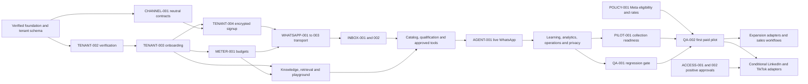

# Execution roadmap

This plan contains **55 tasks**, preserving all 28 V1 IDs and adding 27 omnichannel and sales tasks. The original V1 task definitions remain available in the [V1 roadmap](../kleva-v1/roadmap.md). This document adds provider-neutral scope and direct dependencies. Original acceptance criteria still apply. Where the data design changed, use the provider-neutral contract below. The [tracker](progress-tracker.md) records evidence and status.

| Phase | Exit |
| --- | --- |
| Groundwork | Verified merchant auth, neutral adapter/connection contracts and explicit WhatsApp policy evidence |
| Paid pilot | WhatsApp customer journey, approved knowledge/catalog, safe qualification, inbox and human takeover, learning review, metering and payment collection readiness |
| Expansion | Approved additional channels, verified identity links, orders/booking/payments/follow-ups and automated billing |
| Conditional access | Official LinkedIn/TikTok approval followed by independent implementation only after a positive decision |

The first paid pilot needs two parallel lanes after verified identity. The transport lane is tenant onboarding, encrypted signup, signed durable intake and outbound delivery, then the human inbox. The knowledge and sales lane is published merchant evidence, catalog, scoped retrieval, playground, qualification and the tool registry. Live automation joins them. Learning, analytics, privacy/restore, usage and pilot collection are release gates. Provider app review can run alongside identity verification.

The graph groups workstreams. The task cards list exact prerequisites. Complexity uses Small for a focused change, Medium for a bounded cross-layer slice and Large for an end-to-end integration with substantial concurrency, UI or provider validation. A small team can carry the transport and merchant lanes in parallel after identity verification. Provider approval, rate-card evidence and staging capacity are separate from engineering effort.

Verification commands for proposed suites are targets for the implementing task to add or wire up. The existing repo already has lint, build, unit, HTTP and integration commands. Extend the existing fixtures and CI rather than introducing parallel workflows.

## Groundwork

### FOUNDATION-001 · Restore a green baseline · Small

V1 mapping and adaptation. Retain the verified baseline. The auth-probe lint regression belongs to TENANT-002.

- **Objective.** Retain the reproducible baseline and route new auth failures through TENANT-002.
- **Reuse and likely changes.** src/whatsapp/whatsapp-webhook.controller.ts, test/app.e2e-spec.ts, README.md, DATABASE_SETUP.md and .github/workflows/ci.yml → targeted formatting and setup corrections.
- **Implementation.** Document CI's Node 22 target, actual Meta startup variables, all three migrations, disabled synchronization and stubbed HTTP coverage.
- **Database and API.** **DB/API.** None.
- **Dependencies.** None. **External services.** Local fixtures or the services already provisioned by dependencies.
- **Security.** Use sample credentials and local test services.
- **Acceptance and required tests.** Both lint errors gone and legacy suites pass.
- **Verify.** npm run lint:check && npm run build && npm test && npm run test:e2e.
- **Done.** CI baseline green and setup reproducible from a clean checkout.

### POLICY-001 · Establish official WhatsApp pilot eligibility and cost evidence · Small

- **Objective.** Record approval, window, templates, AI sales terms, country eligibility and rate card for the proposed pilot.
- **Reuse and likely changes.** Reuse Meta signup and V1 QA gates → approved staging checklist and policy evidence.
- **Implementation.** Record approval, window, templates, AI sales terms, country eligibility and rate card for the proposed pilot.
- **Database and API.** No database or API change.
- **Dependencies.** None. **External services.** Meta reviewer, eligible business and test assets.
- **Security.** Restricted use cases stay disabled until written or account-specific evidence.
- **Acceptance and required tests.** An approved asset can send and receive permitted sandbox traffic. Capture versioned terms, scopes and official Nigeria/account pricing.
- **Verify.** Complete the Meta sandbox checklist and attach reviewed evidence.
- **Done.** A reviewer signs off on the versioned WhatsApp eligibility, cost and policy evidence before live activation.

### FOUNDATION-002 · Exercise real PostgreSQL in CI · Medium

V1 mapping and adaptation. Reuse the isolated PostgreSQL/Redis integration harness for all provider and sales fixtures.

- **Objective.** Detect schema and query regressions with the verified real-database baseline.
- **Reuse and likely changes.** src/database/data-source.ts, jest.config.cjs, src/testing/, .github/workflows/ci.yml → test/integration/, Jest config, test:integration script and Postgres CI fixture.
- **Implementation.** Guard disposable DB name, migrate from empty, exercise full down/up and a seeded upgrade, and seed two tenants with colliding names and customer phones. Check real constraints and assistant state.
- **Database and API.** **DB/API.** Test database only.
- **Dependencies.** FOUNDATION-001. **External services.** Disposable PostgreSQL 16.
- **Security.** Prevent connection to the regular application DB. Reserve a non-owner test runtime role.
- **Acceptance and required tests.** Baseline suite checks unique customer/provider keys, persistence and all migration versions.
- **Verify.** npm run test:integration -- baseline.
- **Done.** CI runs the real DB suite and exposes SQL failures.

### FOUNDATION-003 · Consolidate configuration and verified TLS · Medium

V1 mapping and adaptation. Reuse shared configuration, verified TLS, bounded readiness and log redaction.

- **Objective.** Keep API, CLI and worker on the verified shared configuration and production TLS policy.
- **Reuse and likely changes.** src/config/env.ts, src/main.ts, src/database/database.module.ts, src/database/data-source.ts, .env.example → shared typed config and bootstrap health checks.
- **Implementation.** Validate feature-specific configuration, Graph origin, placeholders and production CA. Align DB defaults and add request IDs, structured redaction and bounded readiness checks.
- **Database and API.** **DB.** None. **API.** GET /health/live and /health/ready.
- **Dependencies.** FOUNDATION-002. **External services.** PostgreSQL with a test CA.
- **Security.** Do not emit DSNs, secrets or raw payloads. Restrict production Graph endpoints.
- **Acceptance and required tests.** Invalid env fails cleanly, invalid DB certificate fails closed and DB outage marks unready.
- **Verify.** npm test -- env and npm run test:integration -- readiness.
- **Done.** CLI and API use one validated config and documented profiles.

### FOUNDATION-004 · Run BullMQ from a durable PostgreSQL outbox · Medium

V1 mapping and adaptation. Reuse outbox leases, logical IDs and worker split for every normalized channel. External side effects require their own fence and reconciliation.

- **Objective.** Retain recoverable dispatch and retries through the verified worker and outbox.
- **Reuse and likely changes.** package.json, src/main.ts, src/app.module.ts, src/database/data-source.ts → src/jobs/, src/worker.ts, worker command and Redis CI service.
- **Implementation.** Add durable job intent, relay claims, stable IDs, operation statuses, backoff, expired lease recovery, terminal parking and graceful shutdown.
- **Database and API.** **DB.** Outbox and operation tables with unique logical keys and due indexes. **API.** Scoped operation read contract for feature modules.
- **Dependencies.** FOUNDATION-002. **External services.** Disposable PostgreSQL and Redis.
- **Security.** Queue only IDs and isolate Redis credentials/namespaces.
- **Acceptance and required tests.** Redis outage, crash around enqueue and duplicate job cannot lose or duplicate the test effect.
- **Verify.** npm run test:integration -- outbox.
- **Done.** Worker startup and reconciliation are reproducible locally and in CI.

### TENANT-001 · Migrate membership and tenant integrity · Medium

V1 mapping and adaptation. Reuse accounts, legacy membership backfill and same-tenant keys for new records.

- **Objective.** Preserve existing IDs while adding a membership model. User currently belongs to one business, with global WhatsApp ID uniqueness.
- **Reuse and likely changes.** src/database/entities/{business,user,customer,conversation,message}.entity.ts and migrations → Account, BusinessMember and additive integrity migrations.
- **Implementation.** Detect cross-tenant children/owners and duplicate open records. Backfill membership with legacy user link, repair deterministic ownership and quarantine ambiguous rows. Add composite tenant foreign keys and parent keys on legacy core records.
- **Database and API.** **DB.** Expand, backfill, validate. **API.** None.
- **Dependencies.** FOUNDATION-002. **External services.** Local fixtures or the services already provisioned by dependencies.
- **Security.** Never claim an account via synthetic email or inferred phone ownership.
- **Acceptance and required tests.** Repeatable populated upgrade rejects cross-tenant FKs, preserves IDs and resolves old owner commands.
- **Verify.** npm run test:integration -- membership-migration and npm test -- assistant.
- **Done.** Seeded upgrade and integrity validation recorded.

### TENANT-002 · Authenticate and authorize merchant access · Medium

V1 mapping and adaptation. Finish the implementation present at HEAD. Remove the temporary probe, repair native OIDC loading in Jest, then prove session and RLS behavior under real restricted roles. Keep existing auth routes and verify legacy paths.

- **Objective.** Verify the implemented merchant authentication path and close any regressions shown by the signed local OIDC fixture.
- **Reuse and likely changes.** Reuse src/Auth/, merchant-access SQL grants and the auth migration. Limit changes to the verified auth seam and its tests.
- **Implementation.** OIDC PKCE, cookie session, logout, CSRF, DTO validation and current role check. Add transaction-local tenant context, narrow lookup entry points and forced RLS on tenant tables when their callers are migrated. Protect legacy records before exposing them by API.
- **Database and API.** **DB.** Sessions and runtime-role RLS policies. **API.** Auth routes and /me.
- **Dependencies.** TENANT-001. **External services.** Local signed OIDC fixture, PostgreSQL and Redis for full regression.
- **Security.** Enforce issuer, audience, nonce and redirects. No scope fails closed.
- **Acceptance and required tests.** Login/revocation, roles, CSRF and pooled concurrent tenant isolation pass under runtime role.
- **Verify.** Run lint, build, unit and HTTP tests, then npm run test:integration -- auth-tenant and npm run test:integration.
- **Done.** Auth matrix and tenant failure cases run in CI.

### CHANNEL-001 · Add normalized channel contracts and connection schema · Medium

- **Objective.** Define a provider-neutral port, capability snapshot and connection routing, with no public cutover.
- **Reuse and likely changes.** Reuse Business, phone number routing, OutboxOperation, tenant migration patterns → src/channels and database registry.
- **Implementation.** Define a provider-neutral port, capability snapshot and connection routing, with no public cutover.
- **Database and API.** ChannelConnection and versioned normalized event types. No public route.
- **Dependencies.** TENANT-001, FOUNDATION-004. **External services.** PostgreSQL and Redis fixtures.
- **Security.** Composite tenant keys. Route on verified provider asset. No secrets in DTOs or queue.
- **Acceptance and required tests.** Two fake adapters satisfy the same contract and ambiguous asset ownership fails. Round-trip additive migration and golden event validation.
- **Verify.** npm run test:integration -- channel-contract, plus lint/build and applicable dashboard or provider contract checks.
- **Done.** The schema migration and adapter contract fixtures are green, and the WhatsApp entry point still runs through the current path.

## Paid pilot

### TENANT-003 · Create or claim a business and manage its team · Medium

V1 mapping and adaptation. Business and team workflows serve all channels. Preserve unclaimed legacy identity pending explicit verification.

- **Objective.** Provide self-serve onboarding. WhatsApp registration exists with separate business and owner writes.
- **Reuse and likely changes.** src/onboarding/business-registration.service.ts, src/onboarding/conversation-state.service.ts, src/database/repositories/user.repository.ts → business/member services, checklist and audit writer.
- **Implementation.** Atomic business/owner create for both entry points, verified legacy owner claim, editable profile, invite acceptance, revocation and last-owner guard.
- **Database and API.** **DB.** Invite/challenge tables and actor audit link. **API.** Business, profile, claim, onboarding and team routes.
- **Dependencies.** TENANT-001, TENANT-002. **External services.** Local fixtures or the services already provisioned by dependencies.
- **Security.** Use hashed one-time challenges, attempt limits and verified invitation email. Deliver claims on approved onboarding channel.
- **Acceptance and required tests.** Concurrent create, expired/replayed challenge, role changes and legacy owner access covered.
- **Verify.** npm run test:integration -- business-onboarding and npm test -- onboarding.
- **Done.** Legacy and browser onboarding share consistent persisted identity and audit events.

### TENANT-004 · Harden Embedded Signup and encrypt credentials · Large

V1 mapping and adaptation. Implement verified Embedded Signup against ChannelConnection for provider whatsapp. Keep legacy read compatibility during encrypted cutover.

- **Objective.** Support tenant-safe Meta connection, recovery and disconnect. Current signed callback chooses first assets and persists plaintext.
- **Reuse and likely changes.** src/meta-embedded-signup/, src/whatsapp/whatsapp-cloud-api.service.ts, src/database/entities/business.entity.ts → connection lifecycle, encryption adapter and migration.
- **Implementation.** Bind returned WABA/phone to expiring attempt, active owner/session and live provider permissions. Exchange code synchronously with deadline and store encrypted pending credential. Worker verifies applicable registration/subscription by attempt ID. Preserve prior connection on failed reconnect and keep business status separate.
- **Database and API.** Extend the ChannelConnection schema from CHANNEL-001 with encrypted credential and attempt fields. Preserve the signup, status, completion and disconnect API requirements.
- **Dependencies.** FOUNDATION-003, FOUNDATION-004, TENANT-002, TENANT-003, CHANNEL-001. **External services.** Meta approved test assets and KMS. Start approval lead time early.
- **Security.** No tokens or codes in queues, logs or merchant responses.
- **Acceptance and required tests.** Wrong tenant/asset, replay, expiry, partial Meta failure and disconnect covered.
- **Verify.** npm test -- meta-embedded-signup and npm run test:integration -- connections.
- **Done.** Ciphertext cutover rehearsed and legacy callback uses the verified lifecycle. Live delivery remains a QA-002 gate.

### KNOWLEDGE-001 · Implement knowledge source and revision lifecycle · Medium

V1 mapping and adaptation. Use immutable sources with explicit publication and offer descriptions. Live sales facts come from catalog APIs.

- **Objective.** Give merchants scoped authoring and controlled publication. Missing.
- **Reuse and likely changes.** src/database/data-source.ts, tenant guard and audit writer → src/knowledge/ entities, repository, service and REST.
- **Implementation.** All source kinds, immutable revisions, source-scoped publication pointer, version checks and atomic archive. Existing business profile enters knowledge only via explicit source creation.
- **Database and API.** **DB.** Source/revision migration and uniqueness. **API.** CRUD, archive and publish.
- **Dependencies.** TENANT-003. **External services.** Local fixtures or the services already provisioned by dependencies.
- **Security.** O/E only, bounded content, plain-text rendering and audit.
- **Acceptance and required tests.** Concurrent publish conflicts, draft excluded, foreign revision rejected.
- **Verify.** npm run test:integration -- knowledge-revisions.
- **Done.** Lifecycle works with text and ready-revision fixtures before ingestion.

### METER-001 · Reserve and reconcile model and delivery budgets · Medium

- **Objective.** Cap costs before external work and report tenant usage.
- **Reuse and likely changes.** Reuse outbox, audit and future provider adapters → src/metering and usage view.
- **Implementation.** Cap costs before external work and report tenant usage.
- **Database and API.** UsageEvent, BudgetReservation, versioned rate card, owner GET usage.
- **Dependencies.** FOUNDATION-004, TENANT-003. **External services.** Provider usage fixtures and account rate input.
- **Security.** Atomic limits, safe metadata, idempotency and authorized adjustments.
- **Acceptance and required tests.** Parallel runs cannot overspend, retry does not double charge, and late adjustment reconciles. Include monthly boundary and failure tests.
- **Verify.** npm run test:integration -- usage-budgets, plus lint/build and applicable dashboard or provider contract checks.
- **Done.** Owners can read metered usage and concurrency fixtures show hard budgets hold before external calls.

### DASHBOARD-001 · Build dashboard shell and onboarding · Medium

V1 mapping and adaptation. Use a provider-neutral connection page with one enabled provider and same-origin auth.

- **Objective.** Give merchants a self-serve entry point. Dashboard missing.
- **Reuse and likely changes.** README.md and business/auth contracts → apps/dashboard/ with Next.js, onboarding, overview, connection and business/team screens.
- **Implementation.** Business switcher, role-aware navigation, checklist, device-friendly layout, actionable status and recovery.
- **Database and API.** **DB/API.** Consume tenant and connection endpoints.
- **Dependencies.** TENANT-002, TENANT-003, TENANT-004. **External services.** Local fixtures or the services already provisioned by dependencies.
- **Security.** Same-origin session, no shared caching, secrets stay server-side.
- **Acceptance and required tests.** Sign in, create/claim business, invite member, connect mocked Meta and complete mobile/keyboard walkthrough.
- **Verify.** npm --prefix apps/dashboard test -- onboarding and npm --prefix apps/dashboard run build.
- **Done.** Separate dashboard build and test in CI, protected by deployment flag.

### WHATSAPP-001 · Authenticate and durably acknowledge webhook events · Medium

V1 mapping and adaptation. First ChannelAdapter ingress. Persist normalized receipt and outbox, use one processing owner through cutover.

- **Objective.** Acknowledge valid events promptly. Existing POST verifies HMAC but awaits processing and accepts a reserialized body.
- **Reuse and likely changes.** src/main.ts, src/whatsapp/whatsapp-webhook.controller.ts, src/whatsapp/whatsapp.service.ts, src/whatsapp/types/ → dedicated verification/parser and receipt store.
- **Implementation.** Exact raw-body signature, explicit verify-token config, bounded payload, normalize text/status, route by receiving phone, and atomically insert receipt/outbox before 200. Stage normalized status items until WHATSAPP-003. Unknown events get bounded diagnostic. Storage failure returns 503.
- **Database and API.** **DB.** WebhookReceipt with unique typed provider key. **API.** Preserve GET challenge, define POST acknowledgement and 403/413/503.
- **Dependencies.** TENANT-004, FOUNDATION-004, CHANNEL-001. **External services.** Meta signed webhook fixtures and staged account.
- **Security.** Only designated onboarding phone can enter legacy onboarding. Remove simplified shape from production.
- **Acceptance and required tests.** Raw JSON spacing changes the signature. A valid batched duplicate commits once. The webhook acknowledges after a DB commit during Redis outage and returns a retryable failure during DB outage.
- **Verify.** npm run test:e2e and npm run test:integration -- webhook-receipt.
- **Done.** Shadow intake tested. Enable queued cutover after WHATSAPP-002 and WHATSAPP-003.

### KNOWLEDGE-002 · Add private upload and PDF extraction · Medium

V1 mapping and adaptation. Start with authorized, text-based PDFs and a private storage boundary.

- **Objective.** Ingest text PDFs with attributable pages. Missing.
- **Reuse and likely changes.** Knowledge module and config → src/knowledge/uploads/, storage adapter and sandbox extraction command.
- **Implementation.** Use short-lived upload intent, private versioned object, immutable checksum and size validation. Enforce extraction limits and clean up incomplete uploads.
- **Database and API.** **DB.** UploadIntent and file metadata. **API.** Create and complete upload.
- **Dependencies.** KNOWLEDGE-001. **External services.** Private S3-compatible storage and bounded PDF extractor.
- **Security.** Block foreign objects and public reads. Constrain extractor resources/network.
- **Acceptance and required tests.** Valid PDF yields anchored text. Wrong type, size, encrypted, scanned and cross-tenant uploads fail safely.
- **Verify.** npm run test:integration -- knowledge-uploads.
- **Done.** Verified object versions attach to revisions and timeout/rejection behavior is documented.

### CATALOG-001 · Publish native product and service offers · Medium

- **Objective.** Give merchants authoritative offer data without an external inventory system.
- **Reuse and likely changes.** Reuse Business and knowledge lifecycle patterns → src/catalog and dashboard catalog.
- **Implementation.** Give merchants authoritative offer data without an external inventory system.
- **Database and API.** CatalogOffer with published revisions, explicit optional price/availability, freshness and evidence. GET/POST/PATCH offers and publish route.
- **Dependencies.** TENANT-003, DASHBOARD-001. **External services.** None beyond core environment.
- **Security.** Business-scoped permission and source validation. Unknown stock stays unknown.
- **Acceptance and required tests.** Owner/editor publishes an offer, and price missing/stale cannot be quoted. Version, cross-tenant and currency fixtures.
- **Verify.** npm run test:integration -- catalog-offers, plus lint/build and applicable dashboard or provider contract checks.
- **Done.** The catalog UI publishes attributable offers and the agent-facing read port returns explicit unknowns.

### WHATSAPP-002 · Process inbound turns and legacy commands safely · Large

V1 mapping and adaptation. Keep owner commands and customer processing separate. Persist normalized events against preserved customer and thread IDs.

- **Objective.** Make lead capture, owner commands and conversation ordering retry-safe. Current writes are separate and new lead ownership is wrong.
- **Reuse and likely changes.** src/whatsapp/webhook-lead-capture.service.ts, src/whatsapp/whatsapp.service.ts, src/database/repositories/{customer,conversation,message}.repository.ts, src/assistant/ → inbound worker and transactional scoped repositories.
- **Implementation.** Upsert tenant customer, resolve actual active owner, start one open conversation per connection/customer, persist turn/sequence and next action atomically. Add durable owner command receipt and commit command mutation/state plus reply intent together. Use per-conversation lease/order and equivalent sender order for onboarding and commands.
- **Database and API.** **DB.** Connection link, intake sequence, open uniqueness, scoped owner FK, command effect key and due indexes. **API.** Internal worker contracts.
- **Dependencies.** WHATSAPP-001. **External services.** Local fixtures or the services already provisioned by dependencies.
- **Security.** Check active business/connection and role before effects, protect onboarding from tenant traffic.
- **Acceptance and required tests.** Parallel first messages create one customer/open thread, retry repeats no sale or follow-up, owner can find captured lead, same sender across tenants routes correctly.
- **Verify.** npm test -- assistant and npm run test:integration -- inbound-order.
- **Done.** Real database test proves durable, ordered, scoped processing and compatibility.

### WHATSAPP-003 · Implement safe send and status reconciliation · Large

V1 mapping and adaptation. First outbound adapter. Use common send/status models, tenant send fence and potential-charge budget reservation.

- **Objective.** Persist outbound attempts and delivery outcomes. Existing text adapter returns no provider ID and swallows errors.
- **Reuse and likely changes.** src/whatsapp/whatsapp-cloud-api.service.ts, src/whatsapp/interfaces/whatsapp-cloud-api-client.interface.ts, src/database/entities/message.entity.ts → send worker, status handler and policy service.
- **Implementation.** Return typed Meta results, persist attempts/IDs, classify explicit failures versus uncertain outcomes, enforce window/approved templates and throttles, reconcile early and out-of-order delivery events, and wire legacy replies/notifications.
- **Database and API.** **DB.** SendAttempt, DeliveryEvent and logical send/message uniqueness. **API.** Internal text and template transport. Inbox routes follow.
- **Dependencies.** WHATSAPP-001, METER-001. **External services.** Meta delivery and template fixtures, staged sandbox.
- **Security.** Use encrypted scoped connection with version check. Redact payloads and never blindly retry an uncertain send.
- **Acceptance and required tests.** Status-before-send, duplicate status, 429, permanent failure, timeout ambiguity, closed window and approved-template validation.
- **Verify.** npm run test:integration -- whatsapp-outbound.
- **Done.** Workers expose truthful send state and both inbound/outbound are ready for staged cutover with WHATSAPP-002.

### KNOWLEDGE-003 · Add chunking, embeddings and reindex jobs · Large

V1 mapping and adaptation. Retain generation and reindex behavior with a stable embedding-provider port.

- **Objective.** Build searchable generations and retryable ingestion. Missing.
- **Reuse and likely changes.** Knowledge module, data source and worker → src/knowledge/ingestion/, src/ai/providers/ and chunk migration.
- **Implementation.** Configure pgvector, chunk text/FAQ with anchors, embed bounded batches, check dimensions, stage generation and switch pointer only when ready. Implement the PDF adapter after KNOWLEDGE-002. Reindex, archive and delete with retriable cleanup.
- **Database and API.** **DB.** Extension, chunk and generation constraints, vector and text columns. **API.** Index and operation status.
- **Dependencies.** KNOWLEDGE-001, KNOWLEDGE-002, FOUNDATION-004. **External services.** PostgreSQL with pgvector, embedding fixture and approved provider.
- **Security.** Quotas and scoped writes.
- **Acceptance and required tests.** Duplicate and partial retries preserve one generation, archive during indexing remains archived, prior revision stays active through failure.
- **Verify.** npm run test:integration -- knowledge-ingestion.
- **Done.** All supported inputs index and can be safely retired.

### INBOX-001 · Add conversation and handoff APIs · Large

V1 mapping and adaptation. Use channel-neutral timeline and handoff. First send path is WhatsApp.

- **Objective.** Let merchants operate conversations and fence automated sends. Only inbound persistence exists.
- **Reuse and likely changes.** src/database/entities/{conversation,message}.entity.ts, src/database/repositories/conversation.repository.ts and transport worker → src/inbox/, assignment/note entities and send fence.
- **Implementation.** Scoped timeline, pagination, notes, assignment, takeover, resolve, return-to-AI and manual text/template. Use expected mode version, idempotency keys and shared dispatch lock. Mark pending AI cancelled at takeover, report already-dispatched attempts.
- **Database and API.** **DB.** Handoff, internal notes, mode version, assignment and timeline indexes. **API.** Conversation list/detail/timeline, actions, notes and messages.
- **Dependencies.** WHATSAPP-002, WHATSAPP-003. **External services.** Local fixtures or the services already provisioned by dependencies.
- **Security.** O/A roles, same-tenant assignee, private note channel, and no dispatch after an acknowledged takeover for work that had not been handed to Meta.
- **Acceptance and required tests.** Concurrent takeover/dispatch, new message after resolve, stale version, same-key replay, foreign thread and manual send outside service window.
- **Verify.** npm run test:integration -- inbox-handoff.
- **Done.** An authorized human can control the conversation and get truthful delivery state from API.

### KNOWLEDGE-004 · Build knowledge management screens · Medium

V1 mapping and adaptation. Show revision state, source previews and expiration review dates.

- **Objective.** Let merchants validate and publish knowledge. Missing.
- **Reuse and likely changes.** Dashboard shell, knowledge and upload endpoints → list, editor, preview, indexing progress and revision controls.
- **Implementation.** Support each input type, failure guidance, publish/archive, current revision and setup checklist.
- **Database and API.** **DB/API.** Consume knowledge endpoints.
- **Dependencies.** DASHBOARD-001, KNOWLEDGE-002, KNOWLEDGE-003. **External services.** Local fixtures or the services already provisioned by dependencies.
- **Security.** Render uploads and extracted content safely.
- **Acceptance and required tests.** Text/PDF journeys publish. Failed draft leaves prior version active.
- **Verify.** npm --prefix apps/dashboard test -- knowledge.
- **Done.** Owner/editor can manage a source end-to-end through the browser.

### RAG-001 · Evaluate tenant-scoped hybrid retrieval · Medium

V1 mapping and adaptation. Reuse hybrid pgvector/keyword and evidence filters across all channels.

- **Objective.** Retrieve attributable, published facts. Missing.
- **Reuse and likely changes.** Knowledge chunk schema and embedding adapter → src/knowledge/retrieval/ and labeled eval fixtures.
- **Implementation.** Scoped exact cosine and full-text search, active revision/generation joins, rank fusion, attribution and low-evidence signals. Add Nigerian English/Pidgin and narrow-tenant examples.
- **Database and API.** **DB.** Validate GIN and scoped indexes with query plans. **API.** Internal retrieval port.
- **Dependencies.** KNOWLEDGE-003. **External services.** pgvector and representative evaluation corpus.
- **Security.** Scope before ranking in both retrieval paths.
- **Acceptance and required tests.** Foreign, archived and unpublished chunks never appear. Record top-k recall and p95 latency for seeded pilot load.
- **Verify.** npm run test:integration -- hybrid-retrieval.
- **Done.** Versioned retrieval fixtures and explicit pilot thresholds.

### INBOX-002 · Ship the shared inbox · Medium

V1 mapping and adaptation. One inbox UI with provider badges and server-provided capability state.

- **Objective.** Let merchant staff view and answer conversations. Missing.
- **Reuse and likely changes.** apps/dashboard/ shell and inbox contracts → queue filters, paged timeline, composer and controls.
- **Implementation.** Poll cursor/delivery with backoff, show assignment, mode, internal notes and stale-version prompts. Expose approved template options and in-flight state.
- **Database and API.** **DB/API.** Consume inbox contracts and scoped template allowlist.
- **Dependencies.** DASHBOARD-001, INBOX-001. **External services.** Local fixtures or the services already provisioned by dependencies.
- **Security.** Redact customer previews outside authorized inbox routes. Escape user content.
- **Acceptance and required tests.** Agent can take over, reply, note, assign, resolve and return to AI. Test network retry and closed-window UI.
- **Verify.** npm --prefix apps/dashboard test -- inbox.
- **Done.** Manual support workflow works with a fake provider and is available before automation.

### SALES-001 · Persist leads and opportunities with an activity trail · Medium

- **Objective.** Extend the current CRM with a small merchant-controlled pipeline.
- **Reuse and likely changes.** Reuse Customer, Sale, FollowUp and inbox → src/sales and dashboard leads.
- **Implementation.** Extend the current CRM with a small merchant-controlled pipeline.
- **Database and API.** Lead, Opportunity and SalesActivity. Scoped list/detail and transition routes.
- **Dependencies.** TENANT-003, INBOX-001, CATALOG-001. **External services.** PostgreSQL fixtures.
- **Security.** Explicit transition roles, evidence and actor. Preserve legacy Sale IDs.
- **Acceptance and required tests.** Two tenants can track the same contact identifiers without cross-links. Transition, assignment, concurrency and conversion provenance cases pass.
- **Verify.** npm run test:integration -- lead-opportunity, plus lint/build and applicable dashboard or provider contract checks.
- **Done.** Merchant can view and transition an opportunity with recorded provenance while the legacy CRM still passes regression tests.

### RAG-002 · Add grounded generation, configuration and playground · Large

V1 mapping and adaptation. Grounded generation and read-only playground. The pilot tool policy is introduced separately by TOOLS-001 for live processing.

- **Objective.** Let merchants exercise support AI before activation. Missing.
- **Reuse and likely changes.** Retrieval/provider modules and owner assistant boundary → src/support-agent/, generation adapters, playground and dashboard settings.
- **Implementation.** Typed outcome union, citations validated against retrieved IDs, prompt/context caps, locale/tone configuration, fallbacks, usage and provider deadlines. Use synthetic turns in playground.
- **Database and API.** **DB.** AgentConfiguration and AIUsageRecord. **API.** Config and playground endpoints.
- **Dependencies.** RAG-001, KNOWLEDGE-004, DASHBOARD-001, METER-001. **External services.** Generation/embedding sandbox or deterministic fixture.
- **Security.** No model tools, outbound sends or learning writes from playground.
- **Acceptance and required tests.** Grounding, abstention, injection, Pidgin, invalid output, timeout and budget fixtures.
- **Verify.** npm test -- support-agent, npm run test:integration -- playground and npm --prefix apps/dashboard test -- playground.
- **Done.** Dashboard exposes evidence and outcomes while customer automation remains disabled.

### SALES-002 · Configure qualification fields and manual conversion · Medium

- **Objective.** Deliver a guided opportunity workflow and native merchant capture.
- **Reuse and likely changes.** Reuse sales activity and inbox → sales-policy module and dashboard forms.
- **Implementation.** Deliver a guided opportunity workflow and native merchant capture.
- **Database and API.** Versioned field/consent policy. GET/PATCH sales-policy and manual conversion action.
- **Dependencies.** SALES-001, INBOX-002. **External services.** Pilot merchant sample schemas.
- **Security.** Field purpose and consent, no payment confirmation inferred, safe ownership checks.
- **Acceptance and required tests.** One retailer and one service workflow qualify and record conversion. Missing field, policy version and revoked consent tests pass.
- **Verify.** npm run test:integration -- qualification-policy, plus lint/build and applicable dashboard or provider contract checks.
- **Done.** Both pilot workflow templates can qualify and close an opportunity from the dashboard.

### TOOLS-001 · Enforce typed pilot sales tools · Medium

- **Objective.** Allow approved catalog lookup, lead writes and human escalation in live turns.
- **Reuse and likely changes.** Reuse grounded agent interfaces and catalog/sales/inbox services → src/agent-tools.
- **Implementation.** Allow approved catalog lookup, lead writes and human escalation in live turns.
- **Database and API.** AgentToolExecution ledger and registry with internal tool contracts.
- **Dependencies.** RAG-002, SALES-002, CATALOG-001, INBOX-001. **External services.** Model fixture.
- **Security.** No direct SQL/URL execution. Scope and permission per call. No money or booking tools.
- **Acceptance and required tests.** Grounded offer lookup, denied discounts, idempotent lead write and handoff work. Replay, authorization and injection fixtures pass.
- **Verify.** npm run test:integration -- pilot-tools, plus lint/build and applicable dashboard or provider contract checks.
- **Done.** Live agent can invoke only the approved pilot registry and each effect has replay-safe audit evidence.

### AGENT-001 · Enable grounded WhatsApp answers with bounded memory · Large

V1 mapping and adaptation. Provider-neutral orchestrator processes WhatsApp first. Integrate grounded catalog recommendations and opt-in qualification via bounded tools.

- **Objective.** Send customer answers and hand off when evidence is weak. Missing.
- **Reuse and likely changes.** Inbound worker, support-agent, inbox and src/database/repositories/message.repository.ts → customer orchestrator, conversation summary job and send checks.
- **Implementation.** Use latest public turns and summary watermark, run RAG, disclose AI identity, handle clarification and fallback, create handoff on request or repeated failure, check source freshness and mode/sequence before send, and reserve tenant budget atomically. Default automation off. Owner opt-in requires published knowledge and inbox readiness.
- **Database and API.** **DB.** ConversationSummary, AI run/reply key and coverage watermark. **API.** Activation and safe run metadata.
- **Dependencies.** RAG-002, INBOX-002, TOOLS-001. **External services.** Approved model provider and staged WhatsApp assets.
- **Security.** Never include private notes or another tenant’s data. Model output has no direct write/send authority.
- **Acceptance and required tests.** Two-turn English/Pidgin reply, grounded citations, unsupported handoff, provider outage and late stale reply cancellation.
- **Verify.** npm run test:integration -- whatsapp-support and npm test -- support-agent.
- **Done.** Staging opt-in delivers grounded answers with bounded usage and reversible human control.

### LEARNING-001 · Capture feedback and group redacted gaps · Medium

V1 mapping and adaptation. Retain gap and feedback evidence per tenant with redaction, from any supported channel.

- **Objective.** Surface unanswered questions and review signals. Missing.
- **Reuse and likely changes.** SupportAgent outcomes, message repository, provider adapter → src/learning/gaps/, feedback API and clustering worker.
- **Implementation.** Dedup by origin/reason, redact PII before storage or embeddings, cluster within tenant, and make rating updateable. Start with repeat count of three per tenant cluster before suggesting review, tune after pilot.
- **Database and API.** **DB.** KnowledgeGap, cluster, Feedback and lookup indexes. **API.** Gap list and message feedback.
- **Dependencies.** AGENT-001. **External services.** Local fixtures or the services already provisioned by dependencies.
- **Security.** Use message authorization for ratings and aggregate/redacted data for editors without inbox role.
- **Acceptance and required tests.** Duplicate, foreign, privacy redaction and repeat detection fixtures pass. No gap is searchable as knowledge.
- **Verify.** npm run test:integration -- knowledge-gaps.
- **Done.** Merchant can submit feedback and review redacted recurring topics.

### ANALYTICS-001 · Ship tenant-scoped support analytics · Medium

V1 mapping and adaptation. Retain support metrics and add qualified lead, opportunity and recorded conversion denominators.

- **Objective.** Report support performance and model usage. Legacy sales summaries exist, support analytics missing.
- **Reuse and likely changes.** src/assistant/business-date-range.ts, messages/handoff/usage schema and overview → src/analytics/ and dashboard charts.
- **Implementation.** Use local date buckets with half-open UTC bounds. Count distinct inbound conversations, evidence-backed sent answers, handoff starts and resolves. Report median first accepted response minus first inbound for answered conversations, denominator for response rates, and model tokens/cost by purpose. Aggregate in SQL.
- **Database and API.** **DB.** Scoped date indexes from query plans. **API.** GET /analytics with bounded range and timezone.
- **Dependencies.** AGENT-001. **External services.** Local fixtures or the services already provisioned by dependencies.
- **Security.** Aggregate only, no content or foreign IDs. Preserve seller CRM measures.
- **Acceptance and required tests.** Empty, duplicate status, timezone boundary and tenant fixtures.
- **Verify.** npm run test:integration -- support-analytics and npm --prefix apps/dashboard test -- analytics.
- **Done.** Dashboard and API share documented metric definitions.

### OPS-001 · Monitor, throttle and recover API and workers · Medium

V1 mapping and adaptation. Use common retry, connection, cost, queue and kill-switch metrics.

- **Objective.** Operate queues and budget limits with actionable signals. CI exists, production operations incomplete.
- **Reuse and likely changes.** src/jobs/, src/config/, worker, audit writer and .github/workflows/ci.yml → metrics, recovery controls and deploy/runbook files.
- **Implementation.** Structured correlations, per-tenant quotas and token usage, monitor ack age and latency, backlog, retries, delivery uncertainty, fallback and errors. Add alert rules, connection/tenant kill switches, privileged replay tooling and graceful deploy.
- **Database and API.** **DB.** Budget reservations and audit/replay fields as needed. **API.** Internal-only health/metrics and authorized replay.
- **Dependencies.** AGENT-001. **External services.** Local fixtures or the services already provisioned by dependencies.
- **Security.** Restricted operator role, no content/secret log data, idempotent replay after rechecking policy.
- **Acceptance and required tests.** Throttle one noisy tenant without blocking another, surface parked job, replay safely, switch off AI.
- **Verify.** npm run test:integration -- worker-operations.
- **Done.** Staging alert, failover and rollback runbook exercised.

### LEARNING-002 · Review, approve, publish and replay suggestions · Medium

V1 mapping and adaptation. Use the same merchant-approved publishing workflow. Learning never changes live price, stock or payment facts.

- **Objective.** Turn merchant-confirmed answers into traceable revisions. Missing.
- **Reuse and likely changes.** Knowledge publication/worker, gap service and dashboard → src/learning/suggestions/ and merchant review screens.
- **Implementation.** Draft suggestions, require edited or confirmed answer, audit approve/dismiss, version guard and enqueue revision indexing in one transaction. Auto-publish only the explicitly approved revision after successful indexing and compare-and-set on source/version. Evaluate redacted/synthetic examples on the old and new revision.
- **Database and API.** **DB.** LearningSuggestion with unique active cluster suggestion and approved revision link. **API.** List, edit and decision routes.
- **Dependencies.** LEARNING-001, KNOWLEDGE-003. **External services.** Local fixtures or the services already provisioned by dependencies.
- **Security.** No customer input becomes authoritative without explicit review and publisher provenance.
- **Acceptance and required tests.** Replay approval creates one revision, competing publish preserves new pointer, failed indexing leaves previous knowledge active.
- **Verify.** npm run test:integration -- learning-approval and npm --prefix apps/dashboard test -- learning.
- **Done.** Reviewed improvement is attributable, indexed and measurable from dashboard.

### PILOT-001 · Prepare paid pilot and manual collection · Small

- **Objective.** Define a merchant cap, NGN quote, support coverage, billing event evidence and collection workflow.
- **Reuse and likely changes.** Reuse analytics, usage and operational runbooks → pilot release docs.
- **Implementation.** Define a merchant cap, NGN quote, support coverage, billing event evidence and collection workflow.
- **Database and API.** Manual invoice reference in audited billing record. No automated charge route.
- **Dependencies.** ANALYTICS-001, METER-001, OPS-001. **External services.** Pilot merchants, payment/invoice process and support owner.
- **Security.** Consent and contract review, separate provider charges and Kleva invoices.
- **Acceptance and required tests.** At least one consenting pilot merchant completes setup and agrees price and cap. Reconcile sample invoice, cap and cost ledger.
- **Verify.** Complete the pilot collection checklist and attach reviewed evidence.
- **Done.** Pilot operator has an agreed merchant quote, cap, collection method and support owner, with an auditable invoice rehearsal.

### OPS-002 · Enforce retention, deletion and restore controls · Medium

V1 mapping and adaptation. Cover per-tenant expiry, derived artifacts and verified restore for the expanded schema.

- **Objective.** Limit customer data lifetime and verify recoverability. Missing.
- **Reuse and likely changes.** Message/summary/gap/knowledge schemas, object storage and worker → src/privacy/, purge/export jobs and recovery docs.
- **Implementation.** Implement retention by tenant, redacted audit, authorized export/deletion, purge derived summaries/gaps/embeddings and unreferenced object versions. Track resumable deletion and backup expiry. Restore DB/object storage, reconcile outbox without replaying delivered messages and rebuild queues.
- **Database and API.** **DB.** Retention config, purge jobs and audit. **API.** Owner privacy settings and scoped operations.
- **Dependencies.** LEARNING-002. **External services.** Private versioned object storage, backups and staging restore target.
- **Security.** Reauthenticate destructive actions and restrict exports. Validate pilot retention terms.
- **Acceptance and required tests.** Tenant-scoped purge/retry, archive visibility, missing object and restore drill.
- **Verify.** npm run test:integration -- privacy-retention and staging recovery checklist.
- **Done.** A verified deletion trace and DB/object restore record exist.

### QA-001 · Exercise the full flow and failure matrix in CI · Medium

V1 mapping and adaptation. Preserve original full flow acceptance and add pilot qualification, catalog, usage and tenant capability cases.

- **Objective.** Validate complete behavior with real persistence and mocked providers. The current HTTP smoke covers root and GET challenge. The integration harness is reusable.
- **Reuse and likely changes.** test/app.e2e-spec.ts, test/integration/, .github/workflows/ci.yml, apps/dashboard/ tests → full app/worker fixture and browser flows.
- **Implementation.** Cover browser onboarding, connect, upload, publish, playground, signed webhook, grounded reply, status, manual takeover, feedback/approval, analytics, retention and legacy owner commands. Inject failures around receipt commit, outbox, provider and takeover.
- **Database and API.** **DB/API.** Disposable production-like schemas/roles and real contracts.
- **Dependencies.** ANALYTICS-001, OPS-001, OPS-002, LEARNING-002, TOOLS-001, SALES-002, METER-001. **External services.** CI PostgreSQL, Redis, object storage emulator and mocked providers.
- **Security.** Seed two tenants and check negative authorization, prompt injection and cross-tenant output.
- **Acceptance and required tests.** All checks pass in Node 22 CI, clean and seeded migrations, supported Chromium browser smoke, restore and retry regressions.
- **Verify.** npm run lint:check && npm run build && npm test && npm run test:e2e && npm run test:integration, plus dashboard build/tests.
- **Done.** CI artifacts capture the feature matrix and migration/recovery results.

### QA-002 · Run staged Meta pilot and release gates · Medium

V1 mapping and adaptation. Paid WhatsApp pilot go/no-go. Require official account/terms evidence and payment collection readiness in addition to original staging gates.

- **Objective.** Verify end-to-end behavior on provisioned assets before allowing public traffic. Live Meta and deployment unverified.
- **Reuse and likely changes.** README.md, CI results, architecture, operator and provider runbooks → pilot checklist and release evidence.
- **Implementation.** Confirm app review/permissions, asset signup and disconnection, signed receipt, template approval, actual delivery/read status, regional language samples and human takeover. Exercise loss of Redis, provider downtime, budgets, restore and live-AI rollback.
- **Database and API.** **DB/API.** Staging only until gates pass.
- **Dependencies.** QA-001, POLICY-001, PILOT-001. **External services.** Approved Meta test number, OIDC, object storage, KMS, provider/model credentials and pilot operator.
- **Security.** Use consented test recipients and synthetic support data.
- **Acceptance and required tests.** Zero cross-tenant leaks in agreed isolation suite, no send after takeover fence, no lost accepted receipts after dependency recovery, valid signatures and monitored delivery. Proposed initial targets under agreed pilot load are p95 webhook acknowledgement under 500 ms and p95 supported customer response under 8 seconds, measured through Meta acceptance and excluding delivery latency. Establish eval thresholds from RAG-001 and require approval of support/privacy procedures.
- **Verify.** QA-001 CI commands plus recorded staging replay, real Meta smoke and restore run.
- **Done.** Release owner signs off on test evidence and rollback controls. Enable customer AI for consented pilot tenants only.

## Expansion

### CHANNEL-002 · Add authorized website live chat · Large

- **Objective.** Add first native second channel and validate neutral contracts.
- **Reuse and likely changes.** Reuse channel/inbox modules → website adapter and widget.
- **Implementation.** Add first native second channel and validate neutral contracts.
- **Database and API.** Signed widget sessions and allowlisted domains. Public handshake and message ingress.
- **Dependencies.** QA-002, CHANNEL-001. **External services.** Test merchant domain and browser.
- **Security.** Origin checks, abuse limits, signed anonymous session and no inferred merge.
- **Acceptance and required tests.** Two merchants can embed widgets. Cross-origin, reconnect, handoff and leakage tests pass.
- **Verify.** npm run test:integration -- website-adapter, plus lint/build and applicable dashboard or provider contract checks.
- **Done.** Authorized pilot website can be enabled per tenant with contract and browser evidence.

### CHANNEL-003 · Add Telegram Bot API adapter · Medium

- **Objective.** Support user-initiated bot sales threads and media metadata.
- **Reuse and likely changes.** Reuse channel registry, receipt and send worker → Telegram adapter.
- **Implementation.** Support user-initiated bot sales threads and media metadata.
- **Database and API.** Credential capability rows and scoped connection setup. Official update ingress.
- **Dependencies.** QA-002, CHANNEL-001. **External services.** BotFather and consented test chat.
- **Security.** Secret webhook header, per-chat rate limits and consent. No bulk broadcasts.
- **Acceptance and required tests.** Live test bot receives and replies. Duplicate, unsupported status and rate-limit fixtures pass.
- **Verify.** npm run test:integration -- telegram-adapter, plus lint/build and applicable dashboard or provider contract checks.
- **Done.** Approved test bot is provisioned with tested opt-out and retry behavior.

### CHANNEL-004 · Add Instagram professional messaging adapter · Large

- **Objective.** Enable approved inbound professional-account conversations.
- **Reuse and likely changes.** Reuse Meta credential flow and adapter harness → Instagram adapter.
- **Implementation.** Enable approved inbound professional-account conversations.
- **Database and API.** Instagram capability settings and account mapping. Connect and signed ingress.
- **Dependencies.** QA-002, CHANNEL-001. **External services.** Approved app, professional account and advanced messaging access.
- **Security.** Account-scoped recipient, service window and no automated human-tag bypass.
- **Acceptance and required tests.** Approved test asset receives and replies. Unauthorized asset, window and status fixtures pass.
- **Verify.** npm run test:integration -- instagram-adapter, plus lint/build and applicable dashboard or provider contract checks.
- **Done.** Documented test account and permissions support the approved receive/reply capability before rollout.

### CHANNEL-005 · Add Facebook Messenger Page adapter · Large

- **Objective.** Support approved Page conversations in the shared inbox.
- **Reuse and likely changes.** Reuse Meta signup, scopes and outbound service → Messenger adapter.
- **Implementation.** Support approved Page conversations in the shared inbox.
- **Database and API.** Page asset mapping and recipient namespace. Page connect and ingress.
- **Dependencies.** QA-002, CHANNEL-001. **External services.** Approved Page, app permissions and Page token.
- **Security.** Per-Page recipient scope and tag/window enforcement.
- **Acceptance and required tests.** Sandbox Page can deliver permitted messages. Revocation, 24-hour and retry fixtures pass.
- **Verify.** npm run test:integration -- messenger-adapter, plus lint/build and applicable dashboard or provider contract checks.
- **Done.** Staged Page traffic demonstrates policy-compliant sends, statuses and disconnect recovery.

### CHANNEL-006 · Add one official mailbox provider · Large

- **Objective.** Pick Gmail or Graph based on merchant demand and approved scope.
- **Reuse and likely changes.** Reuse channel worker, credentials and inbox → email adapter.
- **Implementation.** Pick Gmail or Graph based on merchant demand and approved scope.
- **Database and API.** Mailbox connection, thread/message mapping and renewal. Connect and webhook/subscription routes.
- **Dependencies.** QA-002, CHANNEL-001. **External services.** Approved Gmail or Graph app, mailbox and deliverability setup.
- **Security.** Minimal OAuth scopes, sender verification, HTML and attachment sanitization.
- **Acceptance and required tests.** Authorized mailbox ingests and replies. Renewal, retry, duplicate and cross-mailbox fixtures pass.
- **Verify.** npm run test:integration -- email-adapter, plus lint/build and applicable dashboard or provider contract checks.
- **Done.** One scoped mailbox can connect, renew, reply and disconnect through the shared inbox.

### SALES-003 · Create approved draft orders · Large

- **Objective.** Add immutable quotes and controlled order submission with merchant confirmation.
- **Reuse and likely changes.** Reuse catalog, tool policy and opportunities → order service and approvals.
- **Implementation.** Add immutable quotes and controlled order submission with merchant confirmation.
- **Database and API.** Quote, Order, HumanApproval. Draft, review and submit actions.
- **Dependencies.** QA-002, TOOLS-001, CATALOG-001. **External services.** Optional order connector sandbox.
- **Security.** Minor units, confirmed terms, version check, external intent reconciliation.
- **Acceptance and required tests.** Confirmed order submits once. Duplicate confirmation, stale quote and unknown provider outcome fixtures pass.
- **Verify.** npm run test:integration -- approved-orders, plus lint/build and applicable dashboard or provider contract checks.
- **Done.** Approved draft orders have a persisted confirmation, stable operation reference and tested reconciliation.

### SALES-004 · Book confirmed appointments · Large

- **Objective.** Offer available slots and commit only after confirmed consent.
- **Reuse and likely changes.** Reuse service offers, workflow and approvals → booking service.
- **Implementation.** Offer available slots and commit only after confirmed consent.
- **Database and API.** Slot reference, Booking, consent version. Availability and confirm routes.
- **Dependencies.** QA-002, TOOLS-001, CATALOG-001. **External services.** One calendar provider or native pilot calendar.
- **Security.** Enforce slot uniqueness, timezone bounds and consent. Revalidate before retrying a conflict.
- **Acceptance and required tests.** Two simultaneous confirmations produce at most one booking per slot. Revocation and unknown outcome cases pass.
- **Verify.** npm run test:integration -- confirmed-bookings, plus lint/build and applicable dashboard or provider contract checks.
- **Done.** A staged booking provider or native calendar passes conflict and consent verification end to end.

### SALES-006 · Schedule authorized sales follow-ups · Medium

- **Objective.** Send opted-in follow-ups under current channel and pricing policy.
- **Reuse and likely changes.** Reuse FollowUp, BullMQ and send fence → follow-up scheduler.
- **Implementation.** Send opted-in follow-ups under current channel and pricing policy.
- **Database and API.** Consent scope, schedule status and unique logical send. Schedule/cancel routes.
- **Dependencies.** QA-002, SALES-002, WHATSAPP-003. **External services.** Approved template sandbox and consented test number.
- **Security.** Recheck consent, window, template, mode and cap at dispatch. No campaigns.
- **Acceptance and required tests.** Opt-out and takeover stop pending sends. DST/timezone, template and replay tests pass.
- **Verify.** npm run test:integration -- authorized-followups, plus lint/build and applicable dashboard or provider contract checks.
- **Done.** Opted-in scheduled sends pass dispatch eligibility checks and support safe cancellation.

### BILLING-001 · Automate hybrid subscription billing · Large

- **Objective.** Turn pilot pricing and usage ledgers into controlled invoices and optional prepaid top-ups.
- **Reuse and likely changes.** Reuse meter and manual invoice records → billing service and owner usage screens.
- **Implementation.** Turn pilot pricing and usage ledgers into controlled invoices and optional prepaid top-ups.
- **Database and API.** Subscription, invoice and adjustment events. Owner billing endpoints.
- **Dependencies.** QA-002, PILOT-001, METER-001. **External services.** Billing/collection provider, tax and pricing review.
- **Security.** Separate merchant payments, verify webhook, enforce approved cap and avoid duplicate charges.
- **Acceptance and required tests.** Invoice reconciles with ledger, duplicate provider notifications are idempotent and prepaid limits hold.
- **Verify.** npm run test:integration -- hybrid-billing, plus lint/build and applicable dashboard or provider contract checks.
- **Done.** A test invoice reconciles to accepted usage and collects at most once with owner-visible adjustments.

### KNOWLEDGE-005 · Ingest authorized merchant website content · Medium

- **Objective.** Extend ingestion to explicit same-domain sources with bounded fetch and revision review.
- **Reuse and likely changes.** Reuse knowledge source lifecycle, ingestion workers and publication → website source adapter.
- **Implementation.** Extend ingestion to explicit same-domain sources with bounded fetch and revision review.
- **Database and API.** Website consent, origin allowlist, fetch metadata and review date. Source authoring and reindex endpoints.
- **Dependencies.** QA-002, KNOWLEDGE-003. **External services.** Merchant authorization and test site.
- **Security.** Domain ownership, DNS and redirect validation, network allowlists, rate and size bounds, prompt injection isolation.
- **Acceptance and required tests.** Authorized pages index with provenance. Foreign origins, redirect abuse, stale or revoked sites cannot publish.
- **Verify.** npm run test:integration -- authorized-website-ingestion, plus lint/build and applicable dashboard or provider contract checks.
- **Done.** A bounded, authorized website source can be refreshed or revoked with preserved revision history.

### CATALOG-002 · Read authoritative price and inventory from one connector · Large

- **Objective.** Integrate one merchant inventory or commerce system without making it a prerequisite for native catalog.
- **Reuse and likely changes.** Reuse CatalogOffer, tool registry and credential boundary → catalog connector and freshness reconciliation.
- **Implementation.** Integrate one merchant inventory or commerce system without making it a prerequisite for native catalog.
- **Database and API.** External offer map, observation and source versions. Owner connect/status route and internal read APIs.
- **Dependencies.** QA-002, CATALOG-001, TOOLS-001. **External services.** Approved connector credentials and sandbox.
- **Security.** Scoped credentials, verified price currency, freshness TTL and unknown when source fails.
- **Acceptance and required tests.** Stale price and stock never produce a confident quote. Replay, outage and credential revocation fixtures pass.
- **Verify.** npm run test:integration -- catalog-connector, plus lint/build and applicable dashboard or provider contract checks.
- **Done.** One authorized connector supplies fresh prices and stock with verified source and outage fallback.

### SALES-007 · Add explainable merchant-controlled lead scoring · Medium

- **Objective.** Rank qualified leads using versioned deterministic inputs and show reason codes.
- **Reuse and likely changes.** Reuse lead qualification and activity → scoring module and dashboard explanations.
- **Implementation.** Rank qualified leads using versioned deterministic inputs and show reason codes.
- **Database and API.** Versioned scoring policy, score event and bounded replay. Read scores and owner policy endpoint.
- **Dependencies.** QA-002, SALES-002. **External services.** Merchant review corpus.
- **Security.** Do not use inferred sensitive traits, keep evidence and human override.
- **Acceptance and required tests.** Repeat scores are deterministic. Tenant isolation, score version changes, missing fields and overrides tested.
- **Verify.** npm run test:integration -- lead-scoring, plus lint/build and applicable dashboard or provider contract checks.
- **Done.** Versioned scoring reproduces the same evidence-based reasons and preserves operator overrides.

### CHANNEL-009 · Fetch and scan approved channel media · Medium

- **Objective.** Extend normalized attachment metadata into protected retrieval for supported providers.
- **Reuse and likely changes.** Reuse ChannelAdapter media port, private knowledge storage and worker → channel media pipeline.
- **Implementation.** Extend normalized attachment metadata into protected retrieval for supported providers.
- **Database and API.** Attachment state, checksum, expiry and private object references. Scoped temporary access.
- **Dependencies.** QA-002, CHANNEL-001, KNOWLEDGE-002. **External services.** Private object storage, scanner and approved provider media fixture.
- **Security.** Provider-authenticated URL and DNS checks, file caps, malware isolation, no customer content promoted to knowledge.
- **Acceptance and required tests.** Safe media is visible only within its tenant. Corrupt, overlimit, malicious and expired fixtures fail safely.
- **Verify.** npm run test:integration -- channel-media, plus lint/build and applicable dashboard or provider contract checks.
- **Done.** A supported attachment can be fetched and opened by an authorized agent, with purge and scanner evidence.

### IDENTITY-001 · Link verified contacts across channels · Medium

- **Objective.** Permit consented identity link and reversible unlink after a second channel exists.
- **Reuse and likely changes.** Reuse ExternalContactIdentity and Customer → identity-link workflow and audit.
- **Implementation.** Permit consented identity link and reversible unlink after a second channel exists.
- **Database and API.** ConsentEvidence and verified link history. Owner/agent review endpoints.
- **Dependencies.** CHANNEL-002, CHANNEL-001. **External services.** Challenge delivery on both channels or independently verified operator evidence.
- **Security.** Require verified linkage, immutable provenance, scoped lookup and revocation.
- **Acceptance and required tests.** Verified link/unlink preserves thread IDs. Same name and phone alone never link. Replay and foreign evidence tests pass.
- **Verify.** npm run test:integration -- verified-contact-links, plus lint/build and applicable dashboard or provider contract checks.
- **Done.** The verified link and unlink workflow records independent evidence and retains original threads.

### SALES-005 · Generate links and verify payments · Large

- **Objective.** Accept merchant-owned payment links and signed, verified payment evidence.
- **Reuse and likely changes.** Reuse approved orders, outbox and adapter patterns → payment connector.
- **Implementation.** Accept merchant-owned payment links and signed, verified payment evidence.
- **Database and API.** Payment and provider event uniqueness. Link, status and signed webhook.
- **Dependencies.** SALES-003. **External services.** Approved payment provider sandbox and merchant account.
- **Security.** Provider evidence, amount/currency/account checks, no card data or inferred payment.
- **Acceptance and required tests.** Signed event plus independent verification updates exact order once. Replay, wrong amount, reversal and timeout fixtures pass.
- **Verify.** npm run test:integration -- verified-payments, plus lint/build and applicable dashboard or provider contract checks.
- **Done.** A sandbox payment reconciles amount, currency and account to the approved order and exposes a verified status.

## Conditional access

### ACCESS-001 · Verify official LinkedIn access · Small

- **Objective.** Get account-specific permission and decide go/no-go.
- **Reuse and likely changes.** Reuse platform matrix and adapter checklist → access decision.
- **Implementation.** Get account-specific permission and decide go/no-go.
- **Database and API.** No schema or API change.
- **Dependencies.** None. **External services.** LinkedIn partner or product approval.
- **Security.** No scraping, personal automation, or inferred access.
- **Acceptance and required tests.** Record approved endpoints, scopes, geography, fees and sandbox proof or record no-go.
- **Verify.** Complete the official LinkedIn access review and attach reviewed evidence.
- **Done.** A dated decision identifies approved LinkedIn scope and account evidence or closes the integration as no-go.

### ACCESS-002 · Verify official TikTok Business Messaging access · Small

- **Objective.** Confirm Nigeria or pilot market eligibility and approved automation.
- **Reuse and likely changes.** Reuse platform matrix and adapter checklist → access decision.
- **Implementation.** Confirm Nigeria or pilot market eligibility and approved automation.
- **Database and API.** No schema or API change.
- **Dependencies.** None. **External services.** TikTok approved business/developer assets.
- **Security.** No unofficial API or unsupported auto-DMs.
- **Acceptance and required tests.** Record approved messaging and webhook scope, costs and asset-specific sandbox proof or no-go.
- **Verify.** Complete the official TikTok access review and attach reviewed evidence.
- **Done.** A dated decision identifies approved TikTok scope and market evidence or closes the integration as no-go.

### CHANNEL-007 · Integrate approved LinkedIn messaging · Large

- **Objective.** Implement only the contract approved by ACCESS-001.
- **Reuse and likely changes.** Reuse channel registry, outbox and inbox → LinkedIn adapter.
- **Implementation.** Implement only the contract approved by ACCESS-001.
- **Database and API.** Provider route and capability metadata. Authorized connection and ingress endpoints.
- **Dependencies.** QA-002, CHANNEL-001, ACCESS-001. **External services.** Positive access decision and approved sandbox.
- **Security.** Server-enforced scope, purpose and rate caps.
- **Acceptance and required tests.** Official sandbox reply and revocation pass, restricted cases remain disabled.
- **Verify.** npm run test:integration -- linkedin-approved-adapter, plus lint/build and applicable dashboard or provider contract checks.
- **Done.** Only approved account capabilities can be enabled after the provider contract and sandbox checks pass.

### CHANNEL-008 · Integrate approved TikTok Business Messaging · Large

- **Objective.** Implement only the verified market and messaging capabilities.
- **Reuse and likely changes.** Reuse channel registry and inbox → TikTok adapter.
- **Implementation.** Implement only the verified market and messaging capabilities.
- **Database and API.** Provider asset mapping and capability flags. Authorized connection and ingress endpoints.
- **Dependencies.** QA-002, CHANNEL-001, ACCESS-002. **External services.** Positive access decision and approved sandbox.
- **Security.** Enforce account isolation and restrict automation to verified channel policy and scope.
- **Acceptance and required tests.** Approved account accepts normalized inbound and permitted replies. Eligibility, permission and opt-out fixtures pass.
- **Verify.** npm run test:integration -- tiktok-approved-adapter, plus lint/build and applicable dashboard or provider contract checks.
- **Done.** Only approved market and account capabilities can be enabled after the provider contract and sandbox checks pass.
