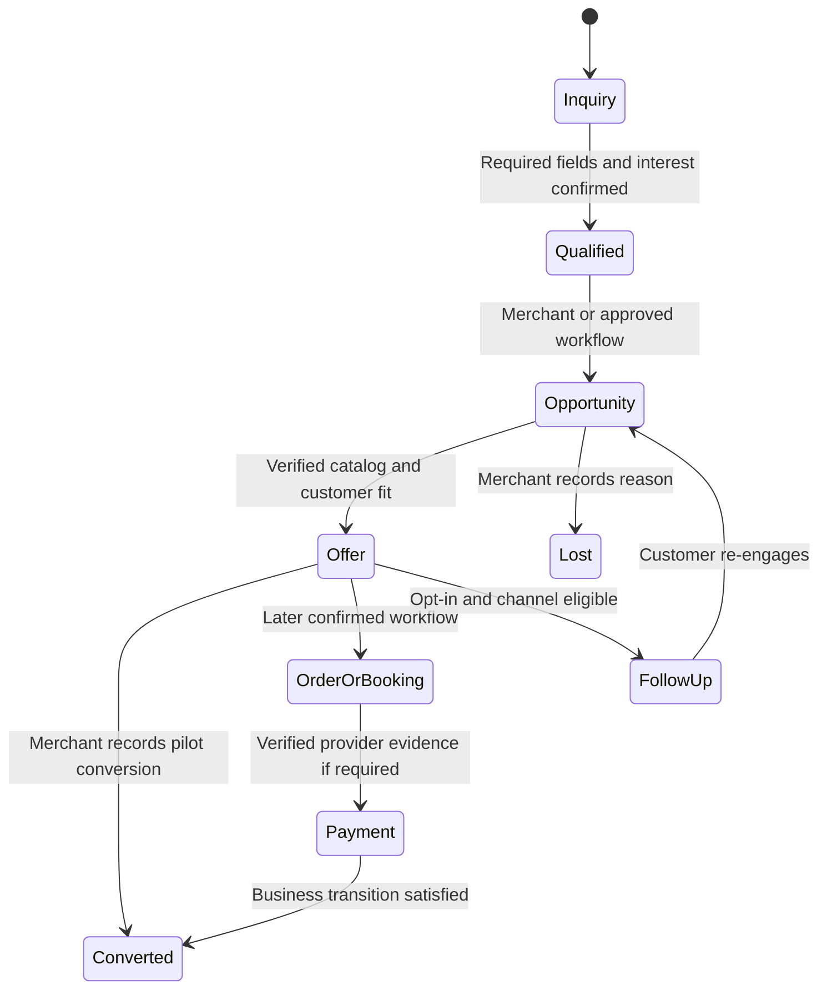

# Sales and CRM workflows

| Stage | Native MVP behavior | Later integration |
| --- | --- | --- |
| Inquiry | Attach incoming message to a tenant contact and thread. Capture explicit purpose and source. | Additional channels and consented identity links |
| Qualification | Merchant-configured required fields, clear interest signal, allowlist, field provenance and confidence. Ask for missing information. | Scoring rules and approved CRM export |
| Opportunity | One active opportunity per configured contact/offer scope with explicit status, assignee and activity history. Keep manual close/reopen. | External opportunity sync via stable mapping and conflict review |
| Recommendation | Native catalog supports product/service, explicit optional price and versioned published availability. Compare only approved offers. Objection handling uses published policy or escalates. | Live inventory or service calendars through connectors |
| Order/booking | Merchant acts through their existing process and records reference or conversion. | Draft quote → explicit customer confirmation → approved submission, compare-and-set and external idempotency |
| Payment | Merchant records conversion and optionally a safe external reference. Never infer payment from a chat message. | Merchant-owned provider account, server-generated link and signed event plus provider verification |
| Follow-up | Native task, due date, owner and consent reminder. Human sends using allowed channel workflow. | Scheduled send after window, template, consent and usage checks |
| Converted/lost | Owner or authorized agent records outcome and reason with timestamp, audit and optional amount. | Reconcile system-confirmed payment/booking, reversals and attributed reporting |

MVP data needs a catalog, lead qualification record, opportunity, activity and an existing FollowUp plus inbox assignment. Avoid mandatory connectors and complex pipelines. Money uses integer minor units plus ISO currency. Pending, verified, refunded, disputed and failed are separate payment outcomes. Merchant-reported conversion and verified paid revenue are separate metrics. Never capture card data. Dedupe by logical operation and provider ID. Double-booking prevention uses deterministic slot locking or provider reservation. On ambiguous provider response, pause and reconcile before retry.

Use approval when a workflow commits money or a slot, sends outside a service window, or applies a discount. Store the immutable requested action, evidence, confirmation and actor. Revoke when a quote, slot, consent, channel permission or membership changes. A handoff or opt-out fences pending AI sends and scheduled follow-ups. See [tool contracts](ai-agent-architecture.md) and [data model](data-model.md).
