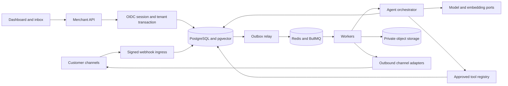
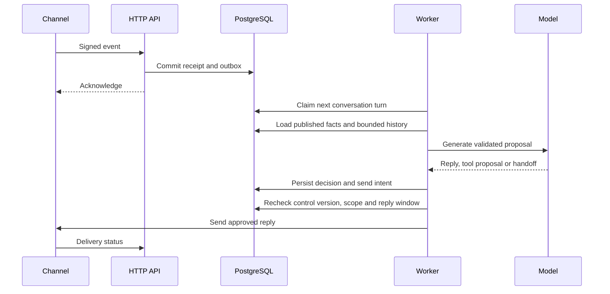

# System architecture

Keep the NestJS modular monolith, PostgreSQL, TypeORM, Redis and BullMQ. Deploy a public HTTP process, a private worker process and a Next.js dashboard from one repository. Serve dashboard and API on one origin. Use S3-compatible private storage for documents and media. Put provider adapters behind application ports so the agent works with a normalized event and tool permissions.

| Boundary | Responsibility |
| --- | --- |
| Merchant identity | Verify provider login, authorize account membership and role per request, scope SQL transaction and record audited mutations |
| Ingress | Verify exact provider evidence, normalize only supported fields, route to one active connection, commit receipt and outbox before returning success |
| Worker | Use PostgreSQL as durable authority, retrieve IDs from queue, enforce ordering and send fences, write outcomes and retry classification |
| Agent | Gather bounded tenant context, retrieve attributed facts, choose typed reply/clarify/handoff/tool proposal, pass execution through deterministic policy |
| Sales services | Own catalog, lead and opportunity changes, external connectors, money and booking state machines and approvals |
| Channel transport | Hold short-lived credential access, enforce recipient/window/capability/rate policy, reconcile provider statuses and ambiguous sends |

Deploy migration role separately from merchant, identity, legacy transport and worker permissions. Merchant transactions set business and session context on a single pooled connection. Existing legacy access is preserved during cutover and never serves merchant CRM reads. Routing and relay require narrow cross-tenant lookup by IDs, with business scope checked again before processing. Model and channel providers have no database access. Keep external effects outside long database transactions.

The read-only playground uses the live grounding engine and a separate run type. It cannot mutate CRM, start approval, send messages, or insert learning candidates. See [agent architecture](ai-agent-architecture.md), [channel contracts](channel-adapter-design.md), and [security](security-and-compliance.md).
