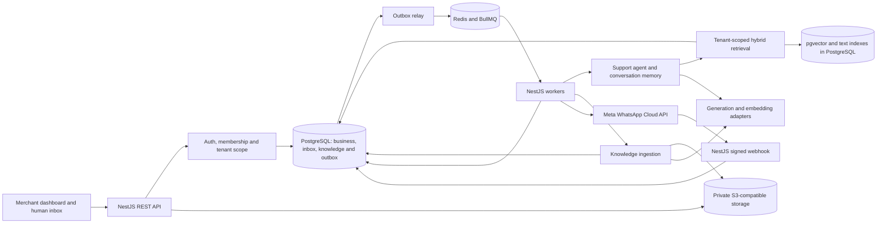
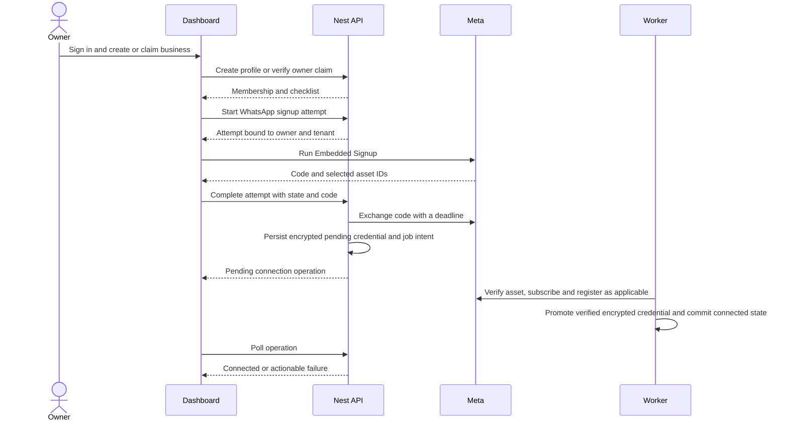
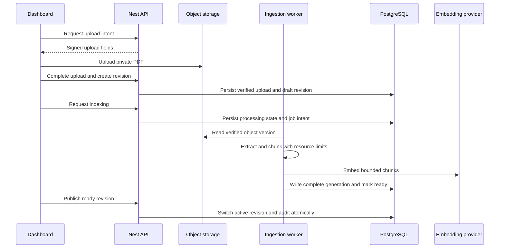
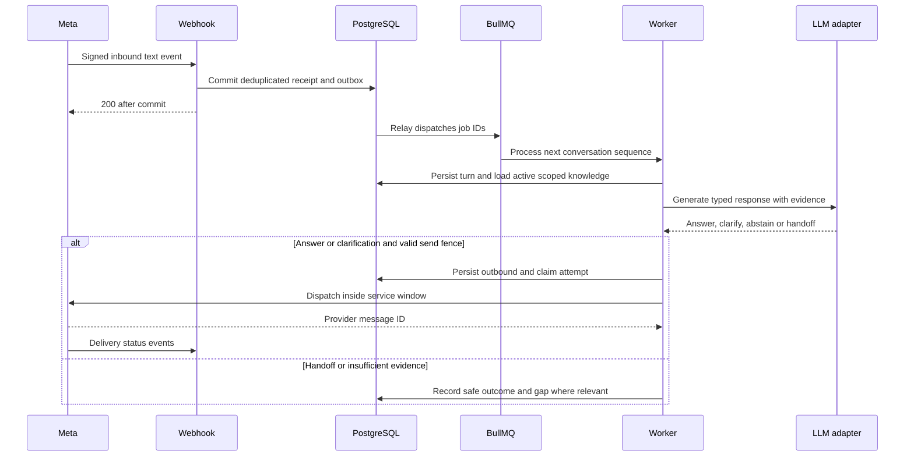
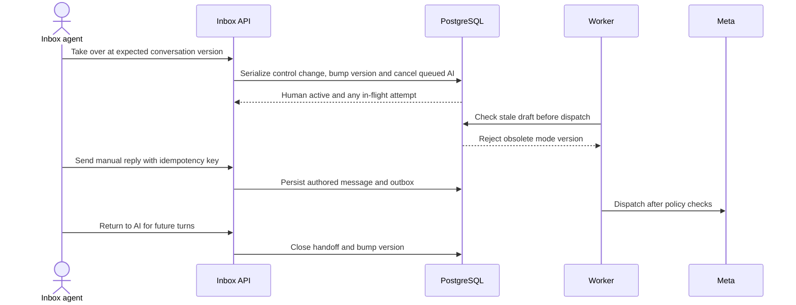
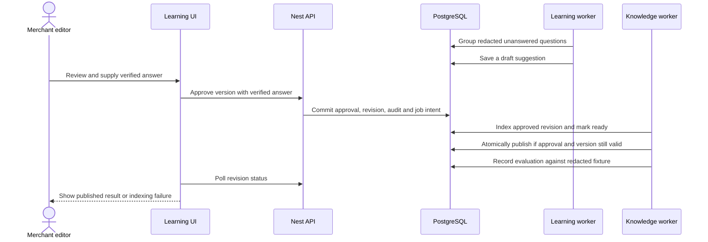

# Kleva V1 architecture

See the [repository audit](repository-audit.md) for current behavior and the [roadmap](roadmap.md) for implementation order. The contracts and operating limits here are proposed pilot defaults.

## System boundaries

Keep NestJS, TypeORM and PostgreSQL. Deploy a modular monolith with a Nest HTTP process and a separate Nest worker entry point from the same codebase. Add Next.js in `apps/dashboard` with its own build and lockfile. Serve the dashboard and API on the same origin through a reverse proxy. PostgreSQL owns business state, durable intake and job intent. Redis and BullMQ schedule work. S3-compatible private object storage holds knowledge files. The existing `AssistantModule` remains the owner's command surface. A separate `SupportAgentModule` handles customer questions with read-only access to approved knowledge and bounded conversation context.

### Tenants, credentials and connection lifecycle

- A verified web identity can join multiple businesses. Every merchant request resolves an active membership for the path business and its required permissions. Owner manages invitations, connection, and settings. Owner and editor manage knowledge, playground and learning. Owner and agent can reply and manage inbox state. All active roles can view the overview and aggregate analytics. Invite grants editor or agent. Initial owner is created atomically with the business. Role changes and revocations take effect on the next request.
- Use an OIDC provider with verified identity, Authorization Code with PKCE, and a server-side revocable session referenced by a secure HttpOnly SameSite cookie. Use exact-origin and CSRF-token checks on cookie-authenticated mutations. Link existing WhatsApp owners using an expiring one-time challenge sent to the recorded owner via the platform onboarding channel when allowed by WhatsApp policy. Bind the challenge to the signed-in account and original tenant. Never infer linkage from phone entered in a browser or synthetic email. Use a controlled support recovery path when the challenge cannot be delivered.
- Scope reads and mutations by tenant and resource ID. Add same-tenant foreign keys and PostgreSQL row-level security for tenant data. Set tenant context transaction-locally on the TypeORM transaction connection. Force RLS on protected tables and use non-owner runtime roles without bypass privileges. Keep the migration role separate. Webhook routing and login use narrowly privileged lookup functions for phone ID and identity/membership mapping. The cross-tenant relay claims only IDs and job metadata through a narrowly scoped path. Workers verify the tenant on each load. [PostgreSQL row security](https://www.postgresql.org/docs/16/ddl-rowsecurity.html).
- One active WhatsApp connection per business for V1. Track it separately from business suspension. Bind Meta’s returned WABA and phone IDs to an expiring, one-time attempt tied to the owner, business, and session. Validate asset ownership/access server-side. Reconcile app subscription and phone registration where required, then mark active. Show pending, action required, connected or disconnected with a safe diagnostic. Keep old connection IDs on historical conversations. Block a phone ID reassignment to a different tenant during the pilot to protect delayed webhook routing and history. Reconnect increments the connection version and invalidates pending sends using obsolete credentials. Test actual grant and registration requirements for the pilot Meta configuration. [Meta Embedded Signup collection](https://www.postman.com/meta/whatsapp-business-platform/documentation/du6gzjv/embedded-signup).
- Envelope-encrypt Meta tokens with a managed KMS, authenticated encryption, and associated data binding ciphertext to its tenant and connection. Store ciphertext, wrapped key, and key version. Restrict decrypt to connection/transport paths. Keep raw tokens and signup codes out of HTTP logs, queues and DTOs. Production Graph origin is allowlisted and PostgreSQL certificate validation is mandatory.

### Knowledge and grounded replies

1. **Source lifecycle.** Accept business descriptions, FAQs, pasted text, product/service descriptions, policies, and text PDFs. Each edit creates an immutable revision. Source has an active revision pointer. Revision transitions `draft → processing → ready → published → archived`, with `processing → failed → processing` for retry. API may show `ready` as “Ready to publish”. Existing published text serves traffic until the new revision is ready and atomically published. Archive immediately removes the pointer from retrieval. A reindex builds a new chunk generation and switches the pointer once complete. Retired rows and objects are removed by a durable cleanup job.
2. **Files.** Private upload intent uses a tenant-generated object key and a short-lived presigned POST, 10 MiB pilot limit. Complete checks the intent, owner, immutable object version/checksum, size, PDF magic and MIME. Extract in a sandboxed process with no network, 100-page limit, CPU/memory/time caps, and no execution of PDF features. Encrypted or image-only files receive a safe error asking for a text PDF. Scope temporary downloads by authorization and expire them quickly. Cleanup only after references are gone and retries are safe. Direct source text defaults to 100,000 characters. Source attribution keeps title, revision, page or FAQ section, and offsets.
3. **Retrieval.** Generate embeddings behind `EmbeddingProvider` with explicit model, dimensions and generation ID. Start with exact cosine distance over active tenant chunks and PostgreSQL full-text search over the same scope. Use the `simple` dictionary as a baseline for names and mixed English/Pidgin and fuse rankings by reciprocal rank. Begin with chunks near 450 tokens and 60 overlap, preserving FAQ pairs and page anchors. Retrieve at most six usable excerpts. Tune limits and abstention on a tenant-curated eval set. Use GIN for keyword search and add approximate search only when measured query latency demands it. Compare exact and approximate recall under narrow tenant filters before introducing HNSW. [pgvector documentation](https://github.com/pgvector/pgvector).
4. **Provider boundary.** `EmbeddingProvider.embed(texts, model, signal)` returns vectors and usage. `GenerationProvider.generate(messages, schema, model, budget, signal)` returns validated data or typed `timeout | throttled | unavailable | invalid_output` plus usage when available. Model and credentials come from deployment config, with per-business limits and approved options. Tests use deterministic fixtures. Move embedding models by building a separate indexed generation with the right dimensions. Cut over tenant-by-tenant after replaying retrieval evaluations.
5. **Context and output.** Assemble system policy, validated agent preferences, active locale, bounded summary through a sequence watermark, latest up to 12 public turns within a context budget, retrieved excerpts, and the latest customer message. Delimit untrusted history and excerpts as data. Allow standard English, conversational Nigerian English and Pidgin. Introduce the assistant as AI in its first automated reply. Require a validated union of `answer {text, citationIds}`, `clarify {text}`, `handoff {reason}`, or `abstain {reason}`. Citations must belong to current tenant retrieval and still be published when sending. Poor evidence, a customer asking for a human, unsupported subjects and recurring failures lead to a clarification or a controlled handoff. Use fixed localized fallback copy for invalid provider output. The model gets no sending, database, or mutation tools. A summary is context with a watermark and can never support a factual claim about the business.
6. **Approval-based learning.** Record an unresolved question with reason, redacted excerpt and conversation reference. Cluster within the tenant by normalized text plus semantic similarity. A draft suggestion can summarize a recurring gap and suggest a question or copy from already approved sources. A merchant must supply or confirm the answer explicitly. Approving creates a source revision with provenance and actor in one transaction. Index successfully before publishing. Feedback and customer conversation text remain untrusted and outside retrieval even if a gap is merged, dismissed, or suggested. Re-run synthetic or redacted examples against the new revision to track improvement.

**Vector decision.** Use pgvector when the hosting plan supports the extension and backup/restore verification. It keeps source publication, relational authorization and vector freshness within the same transactional system. Postgres shares capacity with OLTP, and approximate indexes need memory/recall tuning under tenant filters. A hosted index can offer independent scaling and managed search operations. It adds another data processor and recurring costs, and requires authorization, sync, deletion and reconciliation across stores. If forced by extension availability or proven pilot limits, keep PostgreSQL as the authority, namespace by tenant, and recheck returned chunk IDs against the active revision before using results. Local PostgreSQL lacked the extension during the audit.

### Messaging and inbox

- Verify exact `sha256=<64 hex>` against captured raw bytes. Enforce request size and abuse controls. Resolve provider phone ID before sender classification. Only the explicitly configured platform onboarding phone ID may start or continue legacy onboarding. Match owner commands to an active owner membership for the receiving business. Treat other senders on a connected phone as customers. Signed unsupported or unknown events get a bounded diagnostic and a successful acknowledgement. Valid routable text/status is acknowledged after a PostgreSQL receipt and outbox transaction. Storage failure returns a retryable 503. Process batches without allowing a poison item to block unrelated tenants.
- Deduplicate by provider event identity. Use a receipt for inbound owner and customer messages, and a stable composite status-event key for receipts. Transactionally upsert customer and current conversation, assign a monotonically increasing intake sequence, persist provider timestamp, write message and enqueue the next action. Use `MAX` semantics for last-inbound time. Sequence by durable acceptance order and retain provider time for display. A BullMQ job carries IDs only. Workers claim the next expected sequence with an expiring database lease and compare-and-set on completion. Duplicate jobs or a crash around enqueue cannot repeat CRM mutations. A relay reconciles unpublished outbox and expired leases. Bound retries with jitter, park terminal or exhausted jobs durably, alert, and allow authorized replay of the same logical operation. [BullMQ idempotent jobs](https://docs.bullmq.io/patterns/idempotent-jobs), [retrying failing jobs](https://docs.bullmq.io/guide/retrying-failing-jobs).
- Outbound writes create a logical message and a send attempt, then capture Meta’s message ID on acceptance. Use connection-scoped and recipient-scoped throttles, timeouts and typed failures. Retry documented transient rejection using `Retry-After` where present. A lost response after dispatch is marked uncertain and surfaced for reconciliation. Do not automatically resend an uncertain message. Store provider status events that arrive early for later correlation and fold sent, delivered, read and failed observations without regressing progress. Replay after a provider error must recheck the current service window.
- Before dispatch, check active connection, opt-in where applicable, and the 24-hour service window against the most recent customer inbound timestamp. Outside the window, send only a merchant-selected approved template with validated parameters and consent where required. Keep AI sends inside the window. Route legacy owner notifications through the same policy when using a business number. [WhatsApp Business Messaging Policy](https://whatsappbusiness.com/policy/).
- A conversation has lifecycle `open | resolved` and control `ai_active | human_active`. Start human-active until an owner enables support automation and a usable published source exists. Handoff sets human-active and creates an event for the shared inbox. Agent assignment and notes are internal. Resolve closes the conversation. A new customer message after resolution opens a new conversation. Return to AI is explicit and applies to future turns. Each control transition increments `modeVersion`. An AI draft carries that version and its latest inbound sequence. Cancel stale drafts on mode changes or newer turns and check both before dispatch. Serialize final dispatch claim and takeover with a shared per-conversation lock. Takeover invalidates queued attempts in its transaction and reports any send already handed to Meta as in flight. Such a send can still arrive. Manual and AI messages use the same durable transport and appear with author and delivery state.
- Use per-tenant request, queue, and token budgets. Redact logs and traces by default. Track request ID, pseudonymous resource identifiers, receipt-to-ack time, oldest queued age, send failure and uncertainty rate, response latency, handoff rate, retrieval score distributions, provider latency and cost. Record immutable audit events for membership, connection, publish, AI configuration, takeover, retention and replay. Back up PostgreSQL with PITR and versioned object storage, restore them in a staging drill, and rebuild Redis state from PostgreSQL. Proposed defaults are 90 days for message content, summaries and redacted gap samples, and 365 days for redacted audit events. Enable tenant-level shortening, deletion and export with explicit access checks, data inventory, retryable object/chunk purges, and backup expiry. Use a provider agreement/configuration that limits model-side retention and secondary use. Validate retention and privacy terms with pilot owners before launch.

## Data model and migration

All tenant-scoped tables carry `business_id`. Use a unique parent key on `(business_id,id)` for scoped foreign keys. Use UUIDs, UTC `timestamptz` for new timestamps, and explicit status constraints. Names below are domain names. Existing entities retain their TypeORM table mappings.

| Entity | Fields, relationships and constraints |
| --- | --- |
| **Business** (reuse) | Profile, status, timezone, config. Business status is independent of WhatsApp connectivity. Use `Africa/Lagos` as the registration default and preserve existing values. |
| **BusinessMember** (new) and **Account** (new) | Account uniquely maps verified OIDC issuer+subject. Backfill one membership per legacy User with a unique legacy user link. Nullable account for unclaimed owner, unique business+account when linked. Member has role, status and optional verified WhatsApp sender binding unique within business. TENANT-001 backfills explicit owners and unclaimed staff without verified identity. The legacy user trigger creates and updates unclaimed memberships. Staff has no dashboard permissions until assigned an application role. Legacy user IDs continue to serve existing owner/customer/sales relationships. New dashboard membership logic has one authorization source. |
| **WhatsAppConnection** (new) | Business, WABA/phone IDs, status, display number, credential envelope, connected/disconnected times and version. Unique provider phone ID and one active row per business. One-time signup attempts have hashed nonce, expiry, member and state. |
| **Customer** (reuse) | Preserve tenant-scoped WhatsApp and phone uniqueness, CRM attributes and owner reference. Upsert on provider identity, normalize to E.164 digits where possible, leave collisions for review. |
| **Conversation** (reuse) | Customer, connection, lifecycle, mode/version, assignment, last inbound time, latest sequence. Partial unique open conversation for tenant+connection+customer. Assign via member FK. Internal notes use a separate scoped table. |
| **Message** (reuse) | Conversation, sequence, direction, author kind/member, content, provider ID/time, delivery state, reply-to and attribution snapshot. Unique conversation sequence and logical reply key. Existing global provider message ID constraint may remain for Meta message IDs. |
| **AgentConfiguration** (new) | One row per business with enabled flag, display name, locale, tone, handoff policy, usage caps and version. Defaults disabled. |
| **KnowledgeSource** (new) | Kind, title, creator, archive marker and active revision pointer. Pointer must reference its own source and tenant. |
| **KnowledgeRevision** (new) | Source, version, author, state, checksum, file version or text, provenance, embedding generation, failure code. Unique source+version. |
| **KnowledgeChunk** (new) | Tenant, revision, generation, ordinal, text, vector, keyword index, page/section/offset. Unique revision+generation+ordinal. Retrieval joins active source pointers. |
| **ConversationSummary** (new) | Conversation and covered sequence, safe summary and generation time. Unique conversation+watermark. Purge alongside history. |
| **KnowledgeGap** (new) | Origin message, reason, redacted query, tenant cluster ID and status. Unique origin+reason. |
| **LearningSuggestion** (new) | Gap cluster, draft, version, state, reviewer, approved revision link. One active suggestion per cluster. Transition in transaction with audit. |
| **Feedback** (new) | Message, member, rating and optional redacted reason. Unique member+message, updateable. |
| **Handoff** (new) | Conversation, request reason, actor, start/end, assignee and mode version. One open handoff per conversation. |
| **AIUsageRecord** (new) | Logical run and attempt IDs, tenant, model, purpose, input/output usage, cost estimate and outcome. Unique attempt identifier. Reserve budgets atomically and reconcile actual use. |
| **AuditLog** (reuse) | Business and optional actor member; preserve legacy user reference. Store typed action, entity, safe metadata and time. Limit audit deletion to retention tooling. |
| **Transport and upload tables** (new) | WebhookReceipt, Outbox, SendAttempt, DeliveryEvent, UploadIntent. Unique logical keys and due/lease indexes. References stay tenant-scoped. |

Use additive migrations. Preflight orphaned/foreign-tenant rows, duplicate open conversations and phone collisions. Quarantine ambiguous rows for review and never silently reassign ownership. Backfill membership and encrypted connections idempotently, then validate foreign keys and uniqueness before cutover. Preserve historical conversation IDs. Assign connection only when attributable, otherwise label history as legacy and let the next inbound open a linked conversation. Deploy readers/writers compatible with both shapes during backfill, use feature flags for cutover, compare counts and ciphertext coverage, and remove plaintext columns only after verified cutover and rollback-window expiry. Keep applied migrations immutable. Rollback operationally via feature flags and compatible binaries. Treat destructive downs and plaintext restoration as separate recovery operations.

## REST contracts

Proposed prefix is `/api/v1`. Business-scoped paths below are relative to `/businesses/{businessId}`. Auth, business collection, invite acceptance and owner claim routes are relative to the API prefix. O = owner, E = knowledge editor, A = inbox agent. The server derives membership and author IDs. Responses expose purpose-built DTOs without tokens, provider payloads or sensitive notes in customer-visible channels.

| Method and path | Authorization | Request → success |
| --- | --- | --- |
| `GET /auth/login`, `GET /auth/callback`, `POST /auth/logout`, `GET /me` | Login/callback public with state+PKCE; others session | OIDC redirect/callback; logout 204; `{accountId,memberships:[{businessId,role}]}` |
| `POST /businesses`, `GET /businesses` | Signed-in | `{name,industry,phone,timezone?}` → 201 `{business,member,onboarding}`; GET lists memberships |
| `GET /onboarding`, `PATCH /profile` | GET O/E/A, PATCH O | Checklist with `key,status,nextAction`; patch profile fields → `BusinessProfile` |
| `GET /members`, `POST /invites`, `PATCH /members/{id}`, `POST /invites/accept` (global) | O for management, session for accept | `{email,role}`, `{role?,status?}`, or `{token}` → member or invite status; verified email must match |
| `POST /owner-claim`, `POST /owner-claim/verify` (global) | Session | `{businessRef}` → 202 with generic challenge result; `{challengeId,code}` → linked membership or generic error |
| `GET /whatsapp-connection`, `POST /whatsapp-connection/signup`, `POST /whatsapp-connection/complete`, `DELETE /whatsapp-connection` | O; redacted status available via checklist to E/A | Status DTO; start → `{attemptId,state,configId,expiresAt}`; complete `{attemptId,state,code,wabaId,phoneNumberId}` → 202 operation; disconnect → 202 revoke operation |
| `GET/POST /knowledge-sources`, `GET/PATCH/DELETE /knowledge-sources/{id}` | O/E | Filter by kind/state. Create `{kind,title,text?,uploadId?}` → source plus draft revision. Patch title or create a new revision from edited content. Delete archives and schedules purge → 202. |
| `POST /uploads`, `POST /uploads/{id}/complete` | O/E | `{filename,byteLength,mediaType,checksum}` → 201 `{uploadId,url,fields,expiresAt}`; completion → verified upload status |
| `POST /knowledge-sources/{id}/revisions/{rev}/index`, `POST .../{rev}/publish`, `POST /knowledge-sources/{id}/archive`, `GET /operations/{id}` | O/E; operation auth follows its resource | Index → 202 `{operationId,status}`; publish ready revision with expected version → 200 source; archive → 200 source; operation returns state and safe failure code |
| `GET/PATCH /agent-config`, `POST /playground/runs`, `GET /playground/runs/{id}` | O/E read/test; O config write | Patch validated config fields with expected version. Run `{question,locale?,turns?}` → 202; result includes outcome, reply, source citations, latency and usage, with no live sends or gap writes |
| `GET /conversations`, `GET /conversations/{id}`, `GET /conversations/{id}/messages` | O/A | Cursor filters `status,mode,assignee`; detail includes version, customer display fields, window and last sequence; timeline paginates messages and internal notes |
| `POST /conversations/{id}/messages`, `POST .../{id}/notes`, `POST .../{id}/actions` | O/A | Reply `{text}` or `{templateId,parameters}` → 202 message; note `{text}` → 201; action `{type:takeover/assign/resolve/return_to_ai,memberId?,expectedVersion}` → updated state and any in-flight send |
| `GET /learning/gaps`, `GET /learning/suggestions`, `PATCH /learning/suggestions/{id}`, `POST .../{id}/decision` | O/E | Cursor/status lists; edit `{question,answer,expectedVersion}`; decide `{action:approve/dismiss,expectedVersion}` → review state and optional revision/operation |
| `PUT /messages/{id}/feedback` | O/A | `{rating:helpful/unhelpful,reason?}` → saved feedback |
| `GET /analytics` | O/E/A | `from,to` business-local dates, up to 90 days → bucket counts, resolution and response metrics, usage totals and timezone |

Return `{error:{code,message,requestId,fields?}}`. Use 400 for malformed input, 401 for missing/expired session, 403 for an active same-tenant member lacking permission, and 404 for absent or foreign resources. Use 409 for stale versions, invalid transitions, closed free-text window, or reused idempotency key with different input. Use 413 for upload size, 422 for validly formed inputs that fail domain validation, 429 with retry guidance for budgets, and 503 for temporary unavailability. Require `Idempotency-Key` on retryable creates/commands and scope it by business, actor and route with a payload digest. Use opaque stable cursors, default 25 and max 100, with deterministic ordering and a tie-break ID. Async operations expose queued, running, succeeded or failed. Webhook provider errors have a separate minimal response.

## Merchant dashboard

Start at a checklist with profile, WhatsApp connection, first published source, playground validation, inbox readiness and an explicit activation toggle. Keep the overview actionable with connection health and unresolved conversations. Knowledge lists show revisions, indexing progress, recoverable failures and source previews. Agent settings expose tone and locale with defaults. Playground displays outcomes and citations before activation. Shared inbox shows mode, assignment, notes, delivery and template/window restrictions. Learning shows grouped gaps, redacted evidence and approval history. Analytics covers inbound conversations, grounded answers, handoffs, resolutions and usage. Business and team settings include role management and connection recovery. Include loading, empty, forbidden, failed and offline states, keyboard access, mobile layouts and UTC-to-business-time rendering.

## Critical sequences

### Merchant onboarding and WhatsApp connection

### Knowledge upload and indexing

### Customer message to AI response

### Human handoff

### Merchant-approved learning

