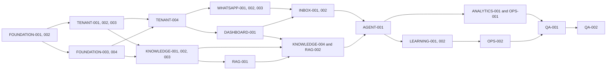

# Kleva V1 implementation roadmap

The [audit](repository-audit.md) establishes the baseline. The [architecture](architecture.md) specifies contracts and lifecycle rules. Each task is a reviewable implementation unit. Preserve legacy owner commands, WhatsApp registration and shared CRM records.

- **Verification.** Existing checks are npm run lint:check, npm run build, npm test and npm run test:e2e. FOUNDATION-002 introduces npm run test:integration -- <suite> against disposable migrated PostgreSQL. Worker suites also use Redis after FOUNDATION-004. DASHBOARD-001 introduces npm --prefix apps/dashboard test -- <suite>. Suite names below are proposed filters.
- **Schema and cutover.** Apply each additive migration before enabling corresponding readers/writers. Verify clean and populated upgrades with real runtime roles. Use feature flags for connection cutover, queued intake, dashboard access and live AI. Maintain a single processing path per event through cutover.
- **External dependencies.** Start Meta app review and asset provisioning in parallel with foundation work. Provision an OIDC IdP, KMS, private versioned object storage, PostgreSQL with pgvector, Redis, worker hosting, and provider sandbox accounts. Reserve live Meta tests for controlled staging.
- **Critical path.** Baseline → tenant boundary → encrypted connection → durable intake/outbound → inbox and dispatch fencing → customer AI. In parallel, build knowledge, retrieval and playground before AI activation. Operations, privacy and staging QA gate public traffic. Exact dependencies are listed on each task.

## Phase 0 · Stabilize and verify the foundation

### FOUNDATION-001 · Restore a green baseline · Small

- **Objective and status.** Make the baseline reproducible. Build and tests pass. Lint fails and database setup docs are stale.
- **Existing files → changes.** src/whatsapp/whatsapp-webhook.controller.ts, test/app.e2e-spec.ts, README.md, DATABASE_SETUP.md and .github/workflows/ci.yml → targeted formatting and setup corrections.
- **Requirements.** Document CI's Node 22 target, actual Meta startup variables, all three migrations, disabled synchronization and stubbed HTTP coverage. **DB/API.** None.
- **Dependencies and security.** None. Use sample credentials and local test services.
- **Acceptance and tests.** Both lint errors gone and legacy suites pass. **Verify.** npm run lint:check && npm run build && npm test && npm run test:e2e.
- **Done.** CI baseline green and setup reproducible from a clean checkout.

### FOUNDATION-002 · Exercise real PostgreSQL in CI · Medium

- **Objective and status.** Detect schema and query regressions. Existing Jest suites substitute TypeORM. CI migration check only reverts the newest two.
- **Existing files → changes.** src/database/data-source.ts, jest.config.cjs, src/testing/, .github/workflows/ci.yml → test/integration/, Jest config, test:integration script and Postgres CI fixture.
- **Requirements.** Guard disposable DB name, migrate from empty, exercise full down/up and a seeded upgrade, and seed two tenants with colliding names and customer phones. Check real constraints and assistant state. **DB/API.** Test database only.
- **Dependencies and security.** FOUNDATION-001. Prevent connection to the regular application DB. Reserve a non-owner test runtime role.
- **Acceptance and tests.** Baseline suite checks unique customer/provider keys, persistence and all migration versions. **Verify.** npm run test:integration -- baseline.
- **Done.** CI runs the real DB suite and exposes SQL failures.

### FOUNDATION-003 · Consolidate configuration and verified TLS · Medium

- **Objective and status.** Align API/CLI config. Current env validation is database-only and production TLS skips verification.
- **Existing files → changes.** src/config/env.ts, src/main.ts, src/database/database.module.ts, src/database/data-source.ts, .env.example → shared typed config and bootstrap health checks.
- **Requirements.** Validate feature-specific configuration, Graph origin, placeholders and production CA. Align DB defaults and add request IDs, structured redaction and bounded readiness checks. **DB.** None. **API.** GET /health/live and /health/ready.
- **Dependencies and security.** FOUNDATION-002. Do not emit DSNs, secrets or raw payloads. Restrict production Graph endpoints.
- **Acceptance and tests.** Invalid env fails cleanly, invalid DB certificate fails closed and DB outage marks unready. **Verify.** npm test -- env and npm run test:integration -- readiness.
- **Done.** CLI and API use one validated config and documented profiles.

### FOUNDATION-004 · Run BullMQ from a durable PostgreSQL outbox · Medium

- **Objective and status.** Make dispatch and retries recoverable. Worker runtime and outbox are missing.
- **Existing files → changes.** package.json, src/main.ts, src/app.module.ts, src/database/data-source.ts → src/jobs/, src/worker.ts, worker command and Redis CI service.
- **Requirements.** Add durable job intent, relay claims, stable IDs, operation statuses, backoff, expired lease recovery, terminal parking and graceful shutdown. **DB.** Outbox and operation tables with unique logical keys and due indexes. **API.** Scoped operation read contract for feature modules.
- **Dependencies and security.** FOUNDATION-002 and Redis. Queue only IDs and isolate Redis credentials/namespaces.
- **Acceptance and tests.** Redis outage, crash around enqueue and duplicate job cannot lose or duplicate the test effect. **Verify.** npm run test:integration -- outbox.
- **Done.** Worker startup and reconciliation are reproducible locally and in CI.

## Phase 1 · Tenant identity and connection

### TENANT-001 · Migrate membership and tenant integrity · Medium

- **Objective and status.** Preserve existing IDs while adding a membership model. User currently belongs to one business, with global WhatsApp ID uniqueness.
- **Existing files → changes.** src/database/entities/{business,user,customer,conversation,message}.entity.ts and migrations → Account, BusinessMember and additive integrity migrations.
- **Requirements.** Detect cross-tenant children/owners and duplicate open records. Backfill membership with legacy user link, repair deterministic ownership and quarantine ambiguous rows. Add composite tenant foreign keys and parent keys on legacy core records. **DB.** Expand, backfill, validate. **API.** None.
- **Dependencies and security.** FOUNDATION-002. Never claim an account via synthetic email or inferred phone ownership.
- **Acceptance and tests.** Repeatable populated upgrade rejects cross-tenant FKs, preserves IDs and resolves old owner commands. **Verify.** npm run test:integration -- membership-migration and npm test -- assistant.
- **Done.** Seeded upgrade and integrity validation recorded.

### TENANT-002 · Authenticate and authorize merchant access · Medium

- **Objective and status.** Establish protected sessions and tenant queries. src/Auth/ is empty.
- **Existing files → changes.** src/Auth/, src/app.module.ts, database module → auth, session and scoped transaction helpers.
- **Requirements.** OIDC PKCE, cookie session, logout, CSRF, DTO validation and current role check. Add transaction-local tenant context, narrow lookup entry points and forced RLS on tenant tables when their callers are migrated. Protect legacy records before exposing them by API. **DB.** Sessions and runtime-role RLS policies. **API.** Auth routes and /me.
- **Dependencies and security.** TENANT-001 and test IdP. Enforce issuer, audience, nonce and redirects. No scope fails closed.
- **Acceptance and tests.** Login/revocation, roles, CSRF and pooled concurrent tenant isolation pass under runtime role. **Verify.** npm run test:integration -- auth-tenant and npm run test:e2e.
- **Done.** Auth matrix and tenant failure cases run in CI.

### TENANT-003 · Create or claim a business and manage its team · Medium

- **Objective and status.** Provide self-serve onboarding. WhatsApp registration exists with separate business and owner writes.
- **Existing files → changes.** src/onboarding/business-registration.service.ts, src/onboarding/conversation-state.service.ts, src/database/repositories/user.repository.ts → business/member services, checklist and audit writer.
- **Requirements.** Atomic business/owner create for both entry points, verified legacy owner claim, editable profile, invite acceptance, revocation and last-owner guard. **DB.** Invite/challenge tables and actor audit link. **API.** Business, profile, claim, onboarding and team routes.
- **Dependencies and security.** TENANT-001, TENANT-002. Use hashed one-time challenges, attempt limits and verified invitation email. Deliver claims on approved onboarding channel.
- **Acceptance and tests.** Concurrent create, expired/replayed challenge, role changes and legacy owner access covered. **Verify.** npm run test:integration -- business-onboarding and npm test -- onboarding.
- **Done.** Legacy and browser onboarding share consistent persisted identity and audit events.

### TENANT-004 · Harden Embedded Signup and encrypt credentials · Large

- **Objective and status.** Support tenant-safe Meta connection, recovery and disconnect. Current signed callback chooses first assets and persists plaintext.
- **Existing files → changes.** src/meta-embedded-signup/, src/whatsapp/whatsapp-cloud-api.service.ts, src/database/entities/business.entity.ts → connection lifecycle, encryption adapter and migration.
- **Requirements.** Bind returned WABA/phone to expiring attempt, active owner/session and live provider permissions. Exchange code synchronously with deadline and store encrypted pending credential. Worker verifies applicable registration/subscription by attempt ID. Preserve prior connection on failed reconnect and keep business status separate. **DB.** Connection/attempt, envelope and version, idempotent backfill. **API.** Start, complete, status, disconnect and compatible legacy callback.
- **Dependencies and security.** FOUNDATION-003, FOUNDATION-004, TENANT-002, TENANT-003, KMS and Meta sandbox. No tokens or codes in queues, logs or merchant responses.
- **Acceptance and tests.** Wrong tenant/asset, replay, expiry, partial Meta failure and disconnect covered. **Verify.** npm test -- meta-embedded-signup and npm run test:integration -- connections.
- **Done.** Ciphertext cutover rehearsed and legacy callback uses the verified lifecycle. Live delivery remains a QA-002 gate.

### DASHBOARD-001 · Build dashboard shell and onboarding · Medium

- **Objective and status.** Give merchants a self-serve entry point. Dashboard missing.
- **Existing files → changes.** README.md and business/auth contracts → apps/dashboard/ with Next.js, onboarding, overview, connection and business/team screens.
- **Requirements.** Business switcher, role-aware navigation, checklist, device-friendly layout, actionable status and recovery. **DB/API.** Consume tenant and connection endpoints.
- **Dependencies and security.** TENANT-002, TENANT-003, TENANT-004. Same-origin session, no shared caching, secrets stay server-side.
- **Acceptance and tests.** Sign in, create/claim business, invite member, connect mocked Meta and complete mobile/keyboard walkthrough. **Verify.** npm --prefix apps/dashboard test -- onboarding and npm --prefix apps/dashboard run build.
- **Done.** Separate dashboard build and test in CI, protected by deployment flag.

## Phase 2 · Knowledge and ingestion

### KNOWLEDGE-001 · Implement knowledge source and revision lifecycle · Medium

- **Objective and status.** Give merchants scoped authoring and controlled publication. Missing.
- **Existing files → changes.** src/database/data-source.ts, tenant guard and audit writer → src/knowledge/ entities, repository, service and REST.
- **Requirements.** All source kinds, immutable revisions, source-scoped publication pointer, version checks and atomic archive. Existing business profile enters knowledge only via explicit source creation. **DB.** Source/revision migration and uniqueness. **API.** CRUD, archive and publish.
- **Dependencies and security.** TENANT-003. O/E only, bounded content, plain-text rendering and audit.
- **Acceptance and tests.** Concurrent publish conflicts, draft excluded, foreign revision rejected. **Verify.** npm run test:integration -- knowledge-revisions.
- **Done.** Lifecycle works with text and ready-revision fixtures before ingestion.

### KNOWLEDGE-002 · Add private upload and PDF extraction · Medium

- **Objective and status.** Ingest text PDFs with attributable pages. Missing.
- **Existing files → changes.** Knowledge module and config → src/knowledge/uploads/, storage adapter and sandbox extraction command.
- **Requirements.** Use short-lived upload intent, private versioned object, immutable checksum and size validation. Enforce extraction limits and clean up incomplete uploads. **DB.** UploadIntent and file metadata. **API.** Create and complete upload.
- **Dependencies and security.** KNOWLEDGE-001 and object storage. Block foreign objects and public reads. Constrain extractor resources/network.
- **Acceptance and tests.** Valid PDF yields anchored text. Wrong type, size, encrypted, scanned and cross-tenant uploads fail safely. **Verify.** npm run test:integration -- knowledge-uploads.
- **Done.** Verified object versions attach to revisions and timeout/rejection behavior is documented.

### KNOWLEDGE-003 · Add chunking, embeddings and reindex jobs · Large

- **Objective and status.** Build searchable generations and retryable ingestion. Missing.
- **Existing files → changes.** Knowledge module, data source and worker → src/knowledge/ingestion/, src/ai/providers/ and chunk migration.
- **Requirements.** Configure pgvector, chunk text/FAQ with anchors, embed bounded batches, check dimensions, stage generation and switch pointer only when ready. Implement the PDF adapter after KNOWLEDGE-002. Reindex, archive and delete with retriable cleanup. **DB.** Extension, chunk and generation constraints, vector and text columns. **API.** Index and operation status.
- **Dependencies and security.** KNOWLEDGE-001, KNOWLEDGE-002, FOUNDATION-004, pgvector and embedding provider fixture. Quotas and scoped writes.
- **Acceptance and tests.** Duplicate and partial retries preserve one generation, archive during indexing remains archived, prior revision stays active through failure. **Verify.** npm run test:integration -- knowledge-ingestion.
- **Done.** All supported inputs index and can be safely retired.

### KNOWLEDGE-004 · Build knowledge management screens · Medium

- **Objective and status.** Let merchants validate and publish knowledge. Missing.
- **Existing files → changes.** Dashboard shell, knowledge and upload endpoints → list, editor, preview, indexing progress and revision controls.
- **Requirements.** Support each input type, failure guidance, publish/archive, current revision and setup checklist. **DB/API.** Consume knowledge endpoints.
- **Dependencies and security.** DASHBOARD-001, KNOWLEDGE-002, KNOWLEDGE-003. Render uploads and extracted content safely.
- **Acceptance and tests.** Text/PDF journeys publish. Failed draft leaves prior version active. **Verify.** npm --prefix apps/dashboard test -- knowledge.
- **Done.** Owner/editor can manage a source end-to-end through the browser.

## Phase 3 · Retrieval and playground

### RAG-001 · Evaluate tenant-scoped hybrid retrieval · Medium

- **Objective and status.** Retrieve attributable, published facts. Missing.
- **Existing files → changes.** Knowledge chunk schema and embedding adapter → src/knowledge/retrieval/ and labeled eval fixtures.
- **Requirements.** Scoped exact cosine and full-text search, active revision/generation joins, rank fusion, attribution and low-evidence signals. Add Nigerian English/Pidgin and narrow-tenant examples. **DB.** Validate GIN and scoped indexes with query plans. **API.** Internal retrieval port.
- **Dependencies and security.** KNOWLEDGE-003. Scope before ranking in both retrieval paths.
- **Acceptance and tests.** Foreign, archived and unpublished chunks never appear. Record top-k recall and p95 latency for seeded pilot load. **Verify.** npm run test:integration -- hybrid-retrieval.
- **Done.** Versioned retrieval fixtures and explicit pilot thresholds.

### RAG-002 · Add grounded generation, configuration and playground · Large

- **Objective and status.** Let merchants exercise support AI before activation. Missing.
- **Existing files → changes.** Retrieval/provider modules and owner assistant boundary → src/support-agent/, generation adapters, playground and dashboard settings.
- **Requirements.** Typed outcome union, citations validated against retrieved IDs, prompt/context caps, locale/tone configuration, fallbacks, usage and provider deadlines. Use synthetic turns in playground. **DB.** AgentConfiguration and AIUsageRecord. **API.** Config and playground endpoints.
- **Dependencies and security.** RAG-001, KNOWLEDGE-004, DASHBOARD-001. No model tools, outbound sends or learning writes from playground.
- **Acceptance and tests.** Grounding, abstention, injection, Pidgin, invalid output, timeout and budget fixtures. **Verify.** npm test -- support-agent, npm run test:integration -- playground and npm --prefix apps/dashboard test -- playground.
- **Done.** Dashboard exposes evidence and outcomes while customer automation remains disabled.

## Phase 4 · Reliable WhatsApp transport

### WHATSAPP-001 · Authenticate and durably acknowledge webhook events · Medium

- **Objective and status.** Acknowledge valid events promptly. Existing POST verifies HMAC but awaits processing and accepts a reserialized body.
- **Existing files → changes.** src/main.ts, src/whatsapp/whatsapp-webhook.controller.ts, src/whatsapp/whatsapp.service.ts, src/whatsapp/types/ → dedicated verification/parser and receipt store.
- **Requirements.** Exact raw-body signature, explicit verify-token config, bounded payload, normalize text/status, route by receiving phone, and atomically insert receipt/outbox before 200. Stage normalized status items until WHATSAPP-003. Unknown events get bounded diagnostic. Storage failure returns 503. **DB.** WebhookReceipt with unique typed provider key. **API.** Preserve GET challenge, define POST acknowledgement and 403/413/503.
- **Dependencies and security.** TENANT-004 and FOUNDATION-004. Only designated onboarding phone can enter legacy onboarding. Remove simplified shape from production.
- **Acceptance and tests.** Raw JSON spacing changes signature; valid batched duplicate commits once; Redis outage still acknowledges; DB outage retries safely. **Verify.** npm run test:e2e and npm run test:integration -- webhook-receipt.
- **Done.** Shadow intake tested. Enable queued cutover after WHATSAPP-002 and WHATSAPP-003.

### WHATSAPP-002 · Process inbound turns and legacy commands safely · Large

- **Objective and status.** Make lead capture, owner commands and conversation ordering retry-safe. Current writes are separate and new lead ownership is wrong.
- **Existing files → changes.** src/whatsapp/webhook-lead-capture.service.ts, src/whatsapp/whatsapp.service.ts, src/database/repositories/{customer,conversation,message}.repository.ts, src/assistant/ → inbound worker and transactional scoped repositories.
- **Requirements.** Upsert tenant customer, resolve actual active owner, start one open conversation per connection/customer, persist turn/sequence and next action atomically. Add durable owner command receipt and commit command mutation/state plus reply intent together. Use per-conversation lease/order and equivalent sender order for onboarding and commands. **DB.** Connection link, intake sequence, open uniqueness, scoped owner FK, command effect key and due indexes. **API.** Internal worker contracts.
- **Dependencies and security.** WHATSAPP-001. Check active business/connection and role before effects, protect onboarding from tenant traffic.
- **Acceptance and tests.** Parallel first messages create one customer/open thread, retry repeats no sale or follow-up, owner can find captured lead, same sender across tenants routes correctly. **Verify.** npm test -- assistant and npm run test:integration -- inbound-order.
- **Done.** Real database test proves durable, ordered, scoped processing and compatibility.

### WHATSAPP-003 · Implement safe send and status reconciliation · Large

- **Objective and status.** Persist outbound attempts and delivery outcomes. Existing text adapter returns no provider ID and swallows errors.
- **Existing files → changes.** src/whatsapp/whatsapp-cloud-api.service.ts, src/whatsapp/interfaces/whatsapp-cloud-api-client.interface.ts, src/database/entities/message.entity.ts → send worker, status handler and policy service.
- **Requirements.** Return typed Meta results, persist attempts/IDs, classify explicit failures versus uncertain outcomes, enforce window/approved templates and throttles, reconcile early and out-of-order delivery events, and wire legacy replies/notifications. **DB.** SendAttempt, DeliveryEvent and logical send/message uniqueness. **API.** Internal text/template transport; inbox routes follow.
- **Dependencies and security.** WHATSAPP-001. Use encrypted scoped connection with version check. Redact payloads and never blindly retry an uncertain send.
- **Acceptance and tests.** Status-before-send, duplicate status, 429, permanent failure, timeout ambiguity, closed window and approved-template validation. **Verify.** npm run test:integration -- whatsapp-outbound.
- **Done.** Workers expose truthful send state and both inbound/outbound are ready for staged cutover with WHATSAPP-002.

## Phase 5 · Inbox and safe customer automation

### INBOX-001 · Add conversation and handoff APIs · Large

- **Objective and status.** Let merchants operate conversations and fence automated sends. Only inbound persistence exists.
- **Existing files → changes.** src/database/entities/{conversation,message}.entity.ts, src/database/repositories/conversation.repository.ts and transport worker → src/inbox/, assignment/note entities and send fence.
- **Requirements.** Scoped timeline, pagination, notes, assignment, takeover, resolve, return-to-AI and manual text/template. Use expected mode version, idempotency keys and shared dispatch lock. Mark pending AI cancelled at takeover, report already-dispatched attempts. **DB.** Handoff, internal notes, mode version, assignment and timeline indexes. **API.** Conversation list/detail/timeline, actions, notes and messages.
- **Dependencies and security.** WHATSAPP-002, WHATSAPP-003. O/A roles, same-tenant assignee, private note channel, and no dispatch after an acknowledged takeover for work that had not been handed to Meta.
- **Acceptance and tests.** Concurrent takeover/dispatch, new message after resolve, stale version, same-key replay, foreign thread and manual send outside service window. **Verify.** npm run test:integration -- inbox-handoff.
- **Done.** An authorized human can control the conversation and get truthful delivery state from API.

### INBOX-002 · Ship the shared inbox · Medium

- **Objective and status.** Let merchant staff view and answer conversations. Missing.
- **Existing files → changes.** apps/dashboard/ shell and inbox contracts → queue filters, paged timeline, composer and controls.
- **Requirements.** Poll cursor/delivery with backoff, show assignment, mode, internal notes and stale-version prompts. Expose approved template options and in-flight state. **DB/API.** Consume inbox contracts and scoped template allowlist.
- **Dependencies and security.** DASHBOARD-001, INBOX-001. Redact customer previews outside authorized inbox routes. Escape user content.
- **Acceptance and tests.** Agent can take over, reply, note, assign, resolve and return to AI. Test network retry and closed-window UI. **Verify.** npm --prefix apps/dashboard test -- inbox.
- **Done.** Manual support workflow works with a fake provider and is available before automation.

### AGENT-001 · Enable grounded WhatsApp answers with bounded memory · Large

- **Objective and status.** Send customer answers and hand off when evidence is weak. Missing.
- **Existing files → changes.** Inbound worker, support-agent, inbox and src/database/repositories/message.repository.ts → customer orchestrator, conversation summary job and send checks.
- **Requirements.** Use latest public turns and summary watermark, run RAG, disclose AI identity, handle clarification and fallback, create handoff on request or repeated failure, check source freshness and mode/sequence before send, and reserve tenant budget atomically. Default automation off. Owner opt-in requires published knowledge and inbox readiness. **DB.** ConversationSummary, AI run/reply key and coverage watermark. **API.** Activation and safe run metadata.
- **Dependencies and security.** RAG-002, INBOX-002. Never include private notes or another tenant’s data. Model output has no direct write/send authority.
- **Acceptance and tests.** Two-turn English/Pidgin reply, grounded citations, unsupported handoff, provider outage and late stale reply cancellation. **Verify.** npm run test:integration -- whatsapp-support and npm test -- support-agent.
- **Done.** Staging opt-in delivers grounded answers with bounded usage and reversible human control.

## Phase 6 · Approval-based learning

### LEARNING-001 · Capture feedback and group redacted gaps · Medium

- **Objective and status.** Surface unanswered questions and review signals. Missing.
- **Existing files → changes.** SupportAgent outcomes, message repository, provider adapter → src/learning/gaps/, feedback API and clustering worker.
- **Requirements.** Dedup by origin/reason, redact PII before storage or embeddings, cluster within tenant, and make rating updateable. Start with repeat count of three per tenant cluster before suggesting review, tune after pilot. **DB.** KnowledgeGap, cluster, Feedback and lookup indexes. **API.** Gap list and message feedback.
- **Dependencies and security.** AGENT-001. Use message authorization for ratings and aggregate/redacted data for editors without inbox role.
- **Acceptance and tests.** Duplicate, foreign, privacy redaction and repeat detection fixtures pass. No gap is searchable as knowledge. **Verify.** npm run test:integration -- knowledge-gaps.
- **Done.** Merchant can submit feedback and review redacted recurring topics.

### LEARNING-002 · Review, approve, publish and replay suggestions · Medium

- **Objective and status.** Turn merchant-confirmed answers into traceable revisions. Missing.
- **Existing files → changes.** Knowledge publication/worker, gap service and dashboard → src/learning/suggestions/ and merchant review screens.
- **Requirements.** Draft suggestions, require edited or confirmed answer, audit approve/dismiss, version guard and enqueue revision indexing in one transaction. Auto-publish only the explicitly approved revision after successful indexing and compare-and-set on source/version. Evaluate redacted/synthetic examples on the old and new revision. **DB.** LearningSuggestion with unique active cluster suggestion and approved revision link. **API.** List, edit and decision routes.
- **Dependencies and security.** LEARNING-001, KNOWLEDGE-003. No customer input becomes authoritative without explicit review and publisher provenance.
- **Acceptance and tests.** Replay approval creates one revision, competing publish preserves new pointer, failed indexing leaves previous knowledge active. **Verify.** npm run test:integration -- learning-approval and npm --prefix apps/dashboard test -- learning.
- **Done.** Reviewed improvement is attributable, indexed and measurable from dashboard.

## Phase 7 · Analytics, operations and privacy

### ANALYTICS-001 · Ship tenant-scoped support analytics · Medium

- **Objective and status.** Report support performance and model usage. Legacy sales summaries exist, support analytics missing.
- **Existing files → changes.** src/assistant/business-date-range.ts, messages/handoff/usage schema and overview → src/analytics/ and dashboard charts.
- **Requirements.** Use local date buckets with half-open UTC bounds. Count distinct inbound conversations, evidence-backed sent answers, handoff starts and resolves. Report median first accepted response minus first inbound for answered conversations, denominator for response rates, and model tokens/cost by purpose. Aggregate in SQL. **DB.** Scoped date indexes from query plans. **API.** GET /analytics with bounded range and timezone.
- **Dependencies and security.** AGENT-001. Aggregate only, no content or foreign IDs. Preserve seller CRM measures.
- **Acceptance and tests.** Empty, duplicate status, timezone boundary and tenant fixtures. **Verify.** npm run test:integration -- support-analytics and npm --prefix apps/dashboard test -- analytics.
- **Done.** Dashboard and API share documented metric definitions.

### OPS-001 · Monitor, throttle and recover API and workers · Medium

- **Objective and status.** Operate queues and budget limits with actionable signals. CI exists, production operations incomplete.
- **Existing files → changes.** src/jobs/, src/config/, worker, audit writer and .github/workflows/ci.yml → metrics, recovery controls and deploy/runbook files.
- **Requirements.** Structured correlations, per-tenant quotas and token usage, monitor ack age and latency, backlog, retries, delivery uncertainty, fallback and errors. Add alert rules, connection/tenant kill switches, privileged replay tooling and graceful deploy. **DB.** Budget reservations and audit/replay fields as needed. **API.** Internal-only health/metrics and authorized replay.
- **Dependencies and security.** AGENT-001. Restricted operator role, no content/secret log data, idempotent replay after rechecking policy.
- **Acceptance and tests.** Throttle one noisy tenant without blocking another, surface parked job, replay safely, switch off AI. **Verify.** npm run test:integration -- worker-operations.
- **Done.** Staging alert, failover and rollback runbook exercised.

### OPS-002 · Enforce retention, deletion and restore controls · Medium

- **Objective and status.** Limit customer data lifetime and verify recoverability. Missing.
- **Existing files → changes.** Message/summary/gap/knowledge schemas, object storage and worker → src/privacy/, purge/export jobs and recovery docs.
- **Requirements.** Implement retention by tenant, redacted audit, authorized export/deletion, purge derived summaries/gaps/embeddings and unreferenced object versions. Track resumable deletion and backup expiry. Restore DB/object storage, reconcile outbox without replaying delivered messages and rebuild queues. **DB.** Retention config, purge jobs and audit. **API.** Owner privacy settings and scoped operations.
- **Dependencies and security.** LEARNING-002, object storage and staging backups. Reauthenticate destructive actions and restrict exports. Validate pilot retention terms.
- **Acceptance and tests.** Tenant-scoped purge/retry, archive visibility, missing object and restore drill. **Verify.** npm run test:integration -- privacy-retention and staging recovery checklist.
- **Done.** A verified deletion trace and DB/object restore record exist.

## Phase 8 · End-to-end verification and pilot readiness

### QA-001 · Exercise the full flow and failure matrix in CI · Medium

- **Objective and status.** Validate complete behavior with real persistence and mocked providers. Current HTTP tests only cover root and GET challenge.
- **Existing files → changes.** test/app.e2e-spec.ts, test/integration/, .github/workflows/ci.yml, apps/dashboard/ tests → full app/worker fixture and browser flows.
- **Requirements.** Cover browser onboarding, connect, upload, publish, playground, signed webhook, grounded reply, status, manual takeover, feedback/approval, analytics, retention and legacy owner commands. Inject failures around receipt commit, outbox, provider and takeover. **DB/API.** Disposable production-like schemas/roles and real contracts.
- **Dependencies and security.** ANALYTICS-001, OPS-001, OPS-002, LEARNING-002. Seed two tenants and check negative authorization, prompt injection and cross-tenant output.
- **Acceptance and tests.** All checks pass in Node 22 CI, clean and seeded migrations, supported Chromium browser smoke, restore and retry regressions. **Verify.** npm run lint:check && npm run build && npm test && npm run test:e2e && npm run test:integration, plus dashboard build/tests.
- **Done.** CI artifacts capture the feature matrix and migration/recovery results.

### QA-002 · Run staged Meta pilot and release gates · Medium

- **Objective and status.** Verify end-to-end behavior on provisioned assets before allowing public traffic. Live Meta and deployment unverified.
- **Existing files → changes.** README.md, CI results, architecture, operator and provider runbooks → pilot checklist and release evidence.
- **Requirements.** Confirm app review/permissions, asset signup and disconnection, signed receipt, template approval, actual delivery/read status, regional language samples and human takeover. Exercise loss of Redis, provider downtime, budgets, restore and live-AI rollback. **DB/API.** Staging only until gates pass.
- **Dependencies and security.** QA-001, real test Meta assets, OIDC, KMS, storage, pgvector, Redis, provider accounts and a named operator. Use consented test recipients and synthetic support data.
- **Acceptance and tests.** Zero cross-tenant leaks in agreed isolation suite, no send after takeover fence, no lost accepted receipts after dependency recovery, valid signatures and monitored delivery. Proposed initial targets under agreed pilot load are p95 webhook acknowledgement under 500 ms and p95 supported customer response under 8 seconds, measured through Meta acceptance and excluding delivery latency. Establish eval thresholds from RAG-001 and require approval of support/privacy procedures. **Verify.** QA-001 CI commands plus recorded staging replay, real Meta smoke and restore run.
- **Done.** Release owner signs off on test evidence and rollback controls. Enable customer AI for consented pilot tenants only.
